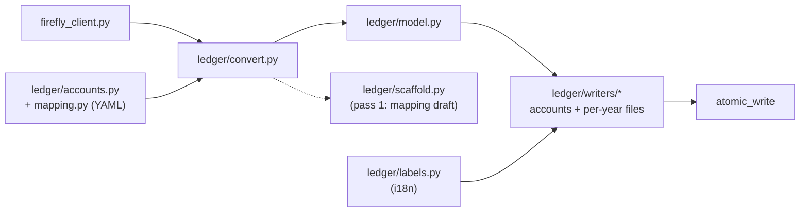

# Architecture

This page explains how firefly-reports is put together since version 2.0: the packages, the
fetch -> build -> write pipeline driven by a registry of report packages, the layering rules that
keep it that way, and the small seams (clock, translator, library facade) that make the output
testable. It is for developers who want to change or extend the code; users should start from
[[Installation]].

## Pipeline

Every `report` run (and every `demo` run) goes through three steps, always in this order:

1. **Fetch.** `reports/fetch.py::fetch_source_data()` calls the Firefly III client and returns one
   immutable `SourceData` value with everything a run needs: transactions of the period (and of the
   previous year in year mode), accounts, liabilities, per-account transactions, budgets and limits,
   bills, piggy banks, instance info, transaction links and, in year mode, the multi-year history.
   The global filters (`--accounts-include`, `--hide-transfers`, ...) are applied here, once.
2. **Build.** `reports/pipeline.py::build_all()` walks the registry in order and calls each report's
   builder. A builder turns `SourceData` into a plain dict (money as `Decimal`). It does no I/O.
3. **Write.** `reports/pipeline.py::write_outputs()` renders one PDF per report and a single Excel
   workbook. A file that fails is logged and reported, never fatal: the run continues and the CLI
   exits with code `3`.

`plan_outputs()` computes the list of files a run would write without writing anything; the
`write_outputs()` loop follows that plan.

## Ledger branch

The Beancount export is a separate branch that shares only the API client, the translations and the
error types: it never goes through the report registry. The client's splits go to `ledger/convert.py`,
which uses `ledger/accounts.py` and the YAML mapping (`mapping.py`) to name the accounts and builds the
neutral model of `ledger/model.py`; the writers in `ledger/writers/` render it, with the translated
strings of `ledger/labels.py`, into the accounts file and the per-year files, which `atomic_write`
replaces on disk. The scaffold (`ledger/scaffold.py`, pass 1) reuses the conversion to draft the mapping
file. Details in [[Ledger-Architecture|Ledger Architecture]].

Diagram: the modules of the ledger branch, from the API client to the files on disk.



## Package map

Everything lives under `firefly_reports/` and is imported with package-qualified absolute imports
(`from firefly_reports.reports.options import Period`).

| Package / module | Role |
|---|---|
| `cli/` | The command line. The only place with `argparse`, `print`, `input`, `sys.exit`, `.env` loading and `./firefly-reports.toml`. `cli/__init__.py` has `main(argv) -> int` and `build_parser()`; one module per subcommand (`report.py`, `export.py`, `init.py`, `demo.py`); `_options.py` resolves credentials, dates and the settings precedence; `_console.py` prints progress lines and sets up the debug log; `_legacy.py` handles the deprecated 1.x form without a subcommand; `config.py` loads the config file and lists the known keys |
| `api.py` | Provisional library facade used by the CLI (see [Library facade](#library-facade)) |
| `reports/` | The report machinery: `registry.py` (`REPORTS`), `spec.py` (`ReportSpec`, `ReportContext`, `SourceData`, `FireflySource`), `options.py` (`Period`, `GlobalFilters`, `ReportOptions`), `fetch.py`, `pipeline.py`, `workbook.py`, `events.py` (progress events), `filters.py`, `_money.py` (`_d`), `_labels.py` |
| `reports/<key>/` | One package per report: `__init__.py` (the `SPEC`), `build.py`, `pdf.py` and, when the report has an Excel sheet, `xlsx.py` |
| `render/` | Rendering helpers shared by many reports that know nothing about reports: `fmt.py` (number, date and period formats), `charts.py` (matplotlib object-oriented API, no `pyplot`), `pdf/` (palette, styles, page template, tables, widgets), `xlsx/` (styles, layout) |
| `ledger/` | The plain-text-accounting export (`firefly-reports export beancount`) |
| `firefly_client.py` | `FireflyClient`, the wrapper of the Firefly III REST API (pagination, flattening of split transactions, rate-limited fetch of linked transactions) |
| `tlstrust/` | TLS trust lists, standard library only: `spki.py` (SPKI SHA-256 of a DER certificate), `lists.py` (the `block` and `warn` entries), `chain.py` (reads the chain OpenSSL verified: public API on Python 3.13+, private binding on 3.11/3.12) and `policy.py` (the verdict). `firefly_client.py` checks the chain right after the handshake, before any request byte is sent |
| `i18n.py` | The translator (see [Translations](#translations)) |
| `clock.py` | The only sanctioned way to read the current time (see [Clock](#clock)) |
| `errors.py` | `FireflyReportsError` and its subclasses `ConfigurationError`, `FireflyAPIError`, `ReportError` (`ledger.errors.LedgerError` derives from it too). An error stores a translation key plus parameters and is rendered when printed, in the language active at that moment |
| `demo/` | `data.py` (sample data) and `client.py` (`DemoClient`, an offline stand-in for `FireflyClient`). `firefly-reports demo` runs the real pipeline on it |
| `main.py`, `demo/__main__.py` | Deprecated shims for `python -m firefly_reports.main` and `python -m firefly_reports.demo`, removed in 3.0 |
| `__main__.py` | `python -m firefly_reports` and the PyInstaller entry point |
| `translations/` | `en.toml` and `it.toml`, one section per area (`[cli]`, `[errors]`, `[ledger]`, `[pdf]`, `[excel]`, ...) |

The 1.x modules `data_processor`, `pdf_exporter`, `excel_exporter`, `chart_engine` and `config` were
removed in 2.0; their code now lives in the report packages, `render/` and `cli/`.

## The report registry

`reports/registry.py` imports every report package explicitly and lists their `SPEC` objects in the
`REPORTS` tuple. There are 28 entries: the 26 reports plus two dashboard views
(`dashboard_income_expense`, `dashboard_kpi_trend`). The order matters:

- it is the order of the sheets in the Excel workbook (the 17 reports that have a sheet come first),
  then the other reports, then the two views;
- builders run in that order, and a report that reads another report's data (`depends_on`) must come
  after it;
- PDFs are written in that order.

Each `ReportSpec` (`reports/spec.py`) describes one report:

| Field | Meaning |
|---|---|
| `key` | The package name, e.g. `savings_goals` |
| `build` | Adapter `from_source(src, ctx, built)` that calls the pure builder with the right inputs. `built` holds the data of the reports already built in this run |
| `pdf` | Renderer `(data, path, legacy=False)`, or `None` |
| `filename` | Function of the `ReportContext` returning the PDF file name |
| `sheet` | Excel sheet writer `(workbook, data)`, or `None` |
| `applies` | Whether the report is built at all for this context (default: always). Used for year-only reports, legacy-only or non-legacy reports, and `--all-tags` |
| `pdf_enabled` | Whether the PDF is written once the data is known (default: always). Used for example to skip empty reports or the `summary` PDF in legacy mode |
| `depends_on` | Keys of reports whose data this one reads |
| `view` | `True` for the two dashboards, which have no builder of their own and derive their data from other reports |

A builder may return `None` to skip its report for the run. Sheets whose data is empty are left out
of the workbook.

`ReportContext` bundles the `Period` (start, end and whether this is a full (fiscal) year) and the
`ReportOptions` (owner, currency, language, legacy mode, tags, filters, PDF/Excel switches, ...). Both
are frozen dataclasses built by the CLI or by a library caller.

## Layering rules

The rules are checked on the source code (with `ast`) by `tests/test_architecture.py`, so a violation
fails the test suite:

- **Builders are pure.** `reports/*/build.py`, `_money`, `_labels`, `filters`, `options` and `spec`
  import none of `reportlab`, `openpyxl`, `matplotlib`, `requests`, `os`, `pathlib`, `io`,
  `firefly_reports.render` or `firefly_reports.cli`.
- **`render/` is report-agnostic.** It imports neither `reports`, `api`, `cli` nor `ledger`.
- **`ledger/` is independent.** It imports none of `reports`, `render`, `cli` or `api`.
- **Network.** `requests` is imported only by `firefly_client.py`, `api.py` and `cli/`.
- **Nothing imports the CLI.** Outside `cli/`, only `__main__.py`, `main.py` and `demo/__main__.py`
  import `firefly_reports.cli` or `firefly_reports.main`.
- **Console and process control.** `print`, `input` and `sys.exit` appear only in `cli/` (and in the
  shims). `ledger/export.py` is grandfathered.
- **No dynamic imports** (`importlib`, `__import__`): PyInstaller follows static imports only, which is
  why the registry imports every report package by name.
- **The registry is complete.** Every `reports/*/` package is in `REPORTS`, and the 1.x module files
  must not come back.

Money is always `Decimal` with two decimal places, produced by `_d()` from `reports/_money.py`; never
a float. Builders must not depend on dict or set iteration order they did not build themselves.

## Clock

`clock.py` provides `now()`, `today()` and the context manager `frozen(at)`. Report code that needs the
current date (the "generated on" line of the PDF header and of the workbook, the budget pace in
`budget_vs_actual` and `budget_forecast`) reads it through `clock`, so tests and the A/B harness can
freeze time and get identical output:

```python
from datetime import datetime

from firefly_reports import clock

with clock.frozen(datetime(2026, 1, 15, 12, 0)):
    assert str(clock.today()) == "2026-01-15"
```

The value is held in a `ContextVar`, so freezing it affects only the current thread or task.

## Translations

`i18n.py` holds one frozen `Translator` per language (catalog plus the English catalog as fallback):

- `i18n.load(lang)` sets the process default; the CLI calls it once after resolving `--lang`.
- `i18n.using(lang)` overrides the language for the current thread or task only (a `ContextVar`); the
  library facade wraps every call in it, so concurrent calls in different languages do not interfere.
- `i18n.t("pdf.category")` looks the dotted key up in the active language, then in English, and finally
  returns the key itself, so a missing translation never crashes a run.
- `i18n.current()` returns the active `Translator`.

Every user-facing string lives in `translations/en.toml` and `translations/it.toml`. Add a new key to
both files.

## Library facade

`firefly_reports/api.py` is the facade the CLI itself uses. Its names are re-exported from
`firefly_reports` (`firefly_reports.__all__`) and are **provisional**: they may change in a minor
release until declared stable. The command line (commands, flags, exit codes, config keys, environment
variables and output file names) is the stable, semantically versioned interface; every other module
is internal.

| Function | Does |
|---|---|
| `connect(url, token)` | Returns a `FireflyClient` |
| `fetch_data(source, period, options)` | Fetch step; request failures become `FireflyAPIError` |
| `build_reports(data, period, options)` | Build step (no files, no network) |
| `write_reports(built, period, options, out_dir)` | Write step; returns a `ReportResult` with `files`, `failures` and the headline figures |
| `generate_reports(source, period, options, out_dir)` | The three steps in one call |
| `available_reports()` | One `ReportInfo` per registry entry: formats, whether it needs year mode, and whether it runs in standard, legacy or both modes |

The facade never prints, reads the environment or exits. Progress is reported through an optional
`progress` callback that receives the events defined in `reports/events.py`; the CLI's
`ProgressPrinter` turns them into the console lines.

A complete offline run with the demo data:

```python
from pathlib import Path

from firefly_reports import Period, ReportOptions, generate_reports
from firefly_reports.demo.client import DemoClient

result = generate_reports(
    DemoClient(),
    Period.for_year(2025),
    ReportOptions(owner="Sample User", lang="en"),
    Path("./output"),
)
print(result.ok, len(result.files))
```

`DemoClient` lives in the internal `demo` package; with a real instance use `connect(url, token)`
instead.

## Command line

`cli/__init__.py::main()` loads `.env` into the environment, reads `./firefly-reports.toml`, rewrites the
deprecated 1.x form (no subcommand) into `report ...` with a warning, parses the arguments, loads the
output language, warns about unknown config keys and dispatches to `report`, `export`, `init` or `demo`.
`FireflyReportsError` becomes `Error: <message>` on stderr and exit code `1`; Ctrl-C gives `130`. The
exit codes and the settings precedence are described in [[Configuration]].

## Adding a report

See [[Adding-a-New-Report|Adding a New Report]].
