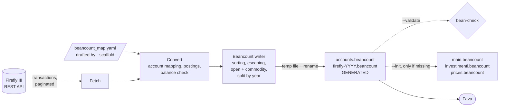
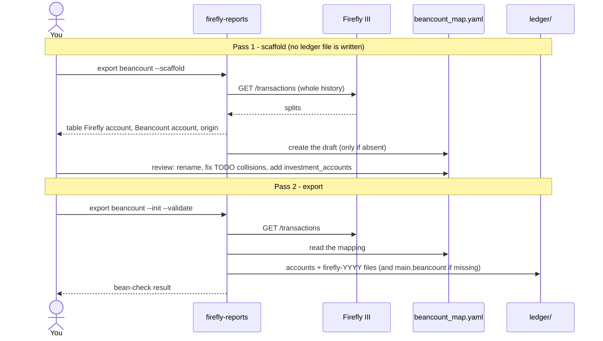
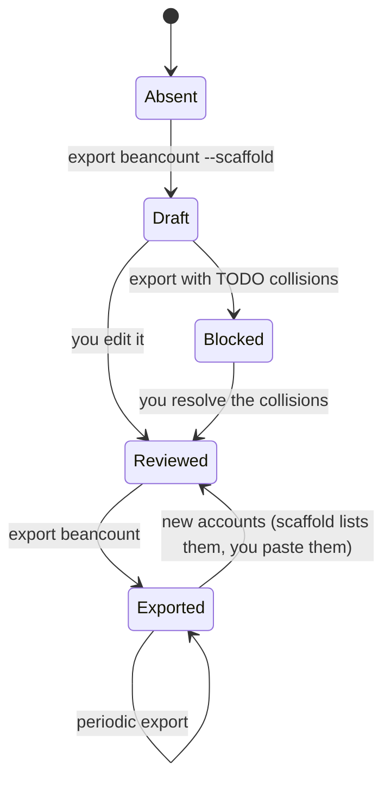
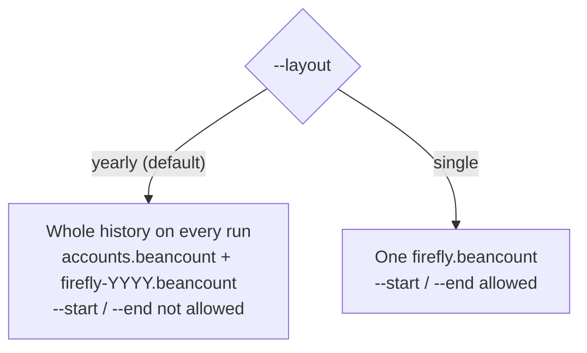
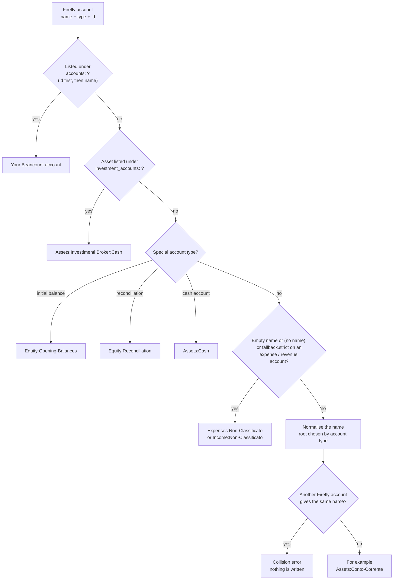
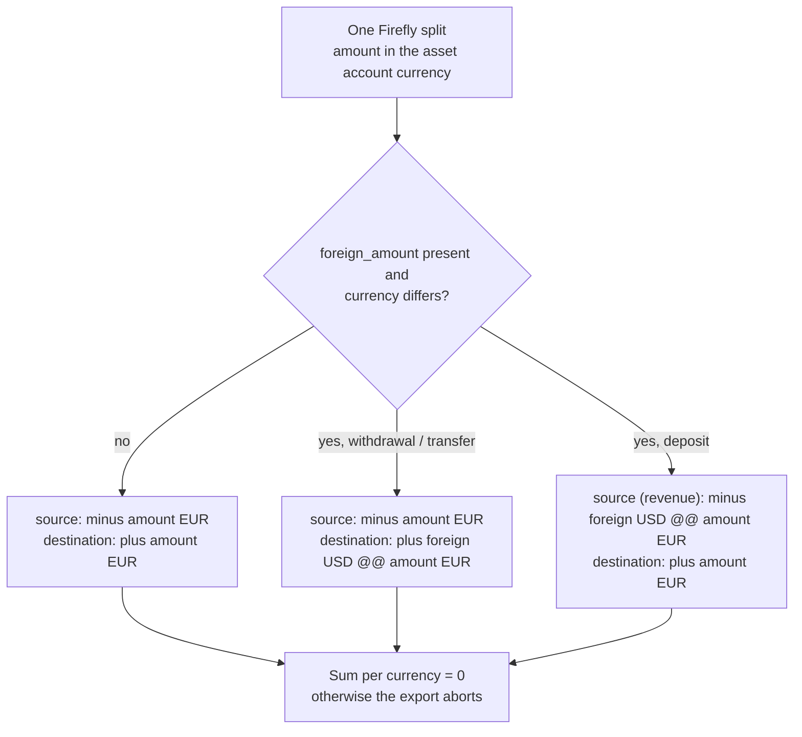
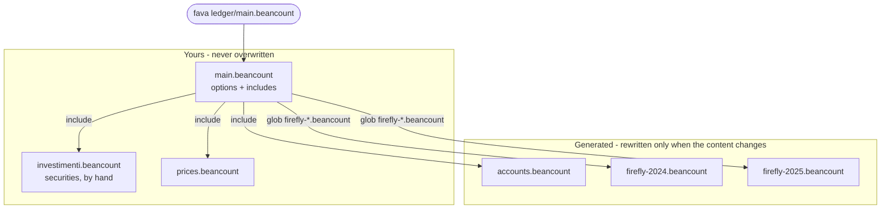
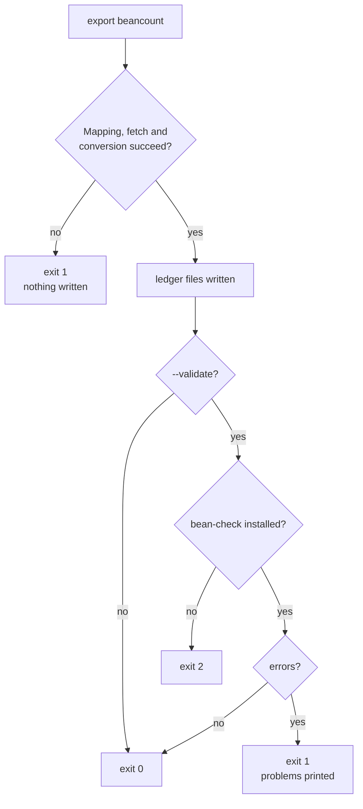

# Beancount Export

`firefly-reports export beancount` converts the transactions stored in Firefly III into
[Beancount](https://beancount.github.io/) v3 files that you can browse, query and audit with
[Fava](https://beancount.github.io/fava/). It reuses the existing API client and the usual credential chain
(`--url`/`--token`, `FIREFLY_URL`/`FIREFLY_TOKEN`, `.env`, `firefly-reports.toml`).

Developer documentation (internals, how to add hledger/ledger): [[Ledger-Architecture|Ledger Architecture]].

**Contents**

1. [What you get](#what-you-get)
2. [Install](#install)
3. [Step-by-step tutorial](#step-by-step-tutorial)
4. [The two passes](#the-two-passes)
5. [Layouts: yearly or single file](#layouts-yearly-or-single-file)
6. [Command reference](#command-reference)
7. [Mapping file reference](#mapping-file-reference)
8. [Worked example](#worked-example)
9. [Mapping rules in detail](#mapping-rules-in-detail)
10. [Recommended ledger layout](#recommended-ledger-layout)
11. [Everyday workflows](#everyday-workflows)
12. [Querying in Fava](#querying-in-fava)
13. [Languages](#languages)
14. [Exit codes](#exit-codes)
15. [Troubleshooting](#troubleshooting)
16. [Known limits](#known-limits)

---

## What you get

* By default (yearly layout) two kinds of generated files: `accounts.beancount` with the `commodity` and `open`
  directives, and one `firefly-YYYY.beancount` per calendar year with the transactions, ordered by date and
  Firefly id. `--layout single` writes one self-contained `firefly.beancount` instead.
* A **first pass** (`--scaffold`) that writes no ledger at all: it only drafts your `beancount_map.yaml`, so you
  can review how every Firefly account will be named before exporting anything.
* Files are **rewritten completely** on every run (never appended), each replaced atomically, and only when
  their content actually changed. Everything is converted and checked before the first file is written, so an
  error leaves your ledger untouched.
* Output is deterministic: the same Firefly data and options always give the same bytes. The `; Generated:`
  timestamp appears only in `accounts.beancount` (and in the `single` layout, where one file holds everything),
  never in the per-year files, which keeps `git diff` of your ledger clean: closed years never change.
  `--no-timestamp` removes it entirely.
* Optionally a minimal `main.beancount` (`--init`) so Fava can open the ledger straight away.
* Cash movements only. Securities lots, prices and quantities are not in Firefly III; you keep them in a
  hand-written file that this tool never touches.

The whole run at a glance:



## Install

```bash
pip install firefly-iii-reports                 # PyYAML is a regular dependency
pip install "firefly-iii-reports[beancount]"    # optional: bean-check, needed only by --validate
pip install fava                                # optional: the web UI
```

From source: `pip install -e ".[dev]"` (the dev extra does not include Beancount; add `.[beancount]` if you
want the integration tests that call `bean-check` to run instead of being skipped).

## Step-by-step tutorial

1. **Make sure credentials are configured** (see [[Configuration]]). Any of these works:
   ```bash
   export FIREFLY_URL=https://firefly.example.com
   export FIREFLY_TOKEN=...            # or put both in .env / firefly-reports.toml
   ```
2. **Pass 1 - draft the account mapping** (writes no ledger file):
   ```bash
   firefly-reports export beancount --scaffold
   ```
   This fetches the whole history, prints a table (Firefly account | type | Beancount account | origin) and creates
   `beancount_map.yaml` **only if it does not exist**. Every automatically named account becomes an active line,
   so the names are frozen: renaming an account in Firefly later will not silently change your ledger.
   Collisions (two accounts that would get the same name) are written as commented `TODO` lines.
3. **Review `beancount_map.yaml`** (the only file you edit by hand): change names or build hierarchies
   (`"Conto Corrente": "Assets:Banca:Intesa:Corrente"`), resolve the `TODO` collisions by uncommenting and
   renaming, move your brokerage account(s) under `investment_accounts:`. See the
   [Mapping file reference](#mapping-file-reference). `beancount_map.yaml` and `ledger/` are already in `.gitignore`.
4. **Pass 2 - export** (writes the ledger, creates the starter files and checks the result):
   ```bash
   firefly-reports export beancount --init --validate
   ```
   This writes `ledger/accounts.beancount` and one `ledger/firefly-YYYY.beancount` per year, creates
   `main.beancount`, `investimenti.beancount` and `prices.beancount` **only if they do not exist**, and runs
   `bean-check`. Use `--dry-run` first if you only want to look at the output.
5. **Open it in Fava**:
   ```bash
   fava ledger/main.beancount        # http://localhost:5000
   ```
6. **Re-run the export whenever you want fresh data.** Only files whose content changed are rewritten. When new
   accounts appear in Firefly, run `--scaffold` again: with an existing mapping file it does not touch it, it only
   prints the accounts you have not mapped yet, ready to paste under `accounts:`.

## The two passes



Life cycle of the mapping file:



What the scaffold writes, per kind of account:

| Origin | In the draft |
|---|---|
| automatic (normalised name) | active line under `accounts:` (frozen) |
| collision | commented line with a `TODO collision` note: the export stops until you give each account its own name |
| name shared by several account types (e.g. an asset and an expense both called `Amazon`) | commented, left automatic (`accounts:` is keyed by name only) |
| special (opening balance, reconciliation, cash), fallback | not listed (nothing to decide) |

It also detects `operating_currency` (the most used currency) and `commodities`, and adds commented examples for
`investment_accounts:` (every asset account listed as a candidate) and `fallback:`.

## Layouts: yearly or single file



* **yearly** (default): closed years never change, so periodic runs only rewrite the current year and git history
  stays small. `accounts.beancount` holds every `open`/`commodity` once (no duplicate `open` problem), dated at the
  first use over the whole history. Because the accounts file always needs the full history, `--start`/`--end`
  are rejected with a clear error.
* **single**: everything in `firefly.beancount`, as in the first version. Allows `--start`/`--end` and suits
  one-off or partial exports.

Switching layout leaves the old files in place and warns about them (see [Troubleshooting](#troubleshooting)).

## Command reference

```
firefly-reports export beancount [options]
```

| Option | Default | Meaning |
|---|---|---|
| `--scaffold` | off | **Pass 1.** Draft the mapping file from the accounts found in Firefly; writes no ledger file. An existing mapping file is never modified (only the not-yet-mapped accounts are printed). With `--dry-run` the draft goes to stdout. Uses `--map` as the file to create (default `./beancount_map.yaml`) |
| `--layout yearly\|single` | `yearly` | `yearly`: `accounts.beancount` + `firefly-YYYY.beancount`; `single`: one `firefly.beancount` |
| `--start YYYY-MM-DD` | none | Earliest transaction date. Only with `--layout single` (and `--scaffold`) |
| `--end YYYY-MM-DD` | none | Latest transaction date. With neither bound the whole history is exported |
| `--map FILE` | `./beancount_map.yaml` if present | Mapping file. An explicit `--map` that does not exist is an error (except with `--scaffold`, which creates it) |
| `--out DIR` | `ledger` | Output **directory** (created if needed) |
| `--dry-run` | off | Print to stdout, write nothing. In the yearly layout each file is preceded by a `; ===== name =====` line. `--init` is ignored. Informational and validation messages go to stderr, so stdout only contains the ledger |
| `--validate` | off | Run `bean-check` and print the problems readably. Single layout: the generated file. Yearly: a temporary file that includes `accounts.beancount` and every year (not your `main.beancount`). With `--dry-run` temporary copies are checked |
| `--init` | off | Create `main.beancount` + empty `investimenti.beancount` / `prices.beancount` in the output directory **if missing** (`main.beancount` includes `accounts.beancount` and `firefly-*.beancount` in the yearly layout) |
| `--no-timestamp` | off | Omit the `; Generated:` line (only written to `accounts.beancount` / the `single` file): byte-identical reruns |
| `--lang en\|it` | from config / `FIREFLY_LANG` / `en` | Language of metadata keys, header, default fallback accounts and messages |
| `--url`, `--token` | from the credential chain | As in the report command. Options can be given before or after `export` |

Date filters are passed straight to the Firefly III API (`/api/v1/transactions`, paginated 100 per page). The tool never deletes files: obsolete generated files (for example a year that no longer has transactions) are only reported.

## Mapping file reference

`beancount_map.yaml` is optional and every section is optional; `--scaffold` drafts it for you. Unknown keys are rejected so typos are not
silently ignored. A complete annotated example ships as `beancount_map.example.yaml`.

```yaml
accounts:
  "Conto Corrente": "Assets:Banca:Intesa:Corrente"
  "12": "Assets:Banca:Intesa:Risparmio"        # numeric Firefly id also works
  "Mutuo Casa": "Liabilities:Mutuo"

investment_accounts:
  "Fineco Investimenti": "Fineco"

investment_root: "Assets:Investimenti"

fallback:
  expense: "Expenses:Non-Classificato"
  income: "Income:Non-Classificato"
  strict: false

operating_currency: [EUR]
commodities: [EUR, USD]

labels:
  category: categoria
  budget: budget
  note: nota
```

| Key | Type | Details |
|---|---|---|
| `accounts` | map | Firefly account **numeric id or name** -> Beancount account. Highest precedence: an entry matching the account **id** wins over one matching the **name** (ids are unique, names can be shared by account types). Many-to-one is allowed (it is explicit). Values must look like `Assets:Foo-Bar`: root is one of `Assets Liabilities Equity Income Expenses`, components start with an uppercase letter or digit and contain only letters, digits and `-`. A name mapping that lands in a root different from the one expected for the account type is kept, with a warning |
| `investment_accounts` | map | Firefly **asset** account (name or id) -> broker name. Becomes `<investment_root>:<Broker>:Cash`; the broker is normalised (`"Banca Ünica"` -> `Banca-Unica`). Several Firefly accounts may share a broker |
| `investment_root` | account | Default depends on `--lang`: `Assets:Investimenti` (it), `Assets:Investments` (en) |
| `fallback.expense` / `fallback.income` | account | Target for counterparts with an empty or `(no name)` name. Defaults follow `--lang` (`Expenses:Non-Classificato` / `Expenses:Uncategorized`, ...) |
| `fallback.strict` | bool | `true`: every expense/revenue account **not** listed under `accounts` goes to the fallback instead of being auto-named. Useful to force a curated chart of accounts. Asset and liability accounts are never affected |
| `operating_currency` | list | Written as `option "operating_currency"` in the `main.beancount` created by `--init`. Default: the most used currency |
| `commodities` | list | Extra `commodity` directives for currencies that no transaction uses yet. Used currencies are always declared |
| `labels` | map | Force metadata key names for `category`, `budget`, `note`, independent of `--lang`. Keys must match `[a-z][a-zA-Z0-9_-]*` |

Resolution order for an account: `accounts` (numeric id first, then name) -> `investment_accounts` -> special accounts (opening balance,
reconciliation, cash) -> fallback (empty name, or strict mode) -> automatic normalisation.



The first rule that matches wins. Collisions are only checked for names generated automatically.

## Worked example

Firefly III data (simplified):

| id | type | date | amount | from -> to | notes |
|---|---|---|---|---|---|
| 3 | withdrawal | 2025-01-20 | 42.50 EUR | Conto Corrente -> Caffè Münch & Söhne | description `Cena "da Mario"`, category Ristoranti, budget Svago |
| 5 (group, 3 splits) | withdrawal | 2025-02-08 | 30.00 + 12.40 + 7.10 EUR | Conto Corrente -> Supermercato Più / Farmacia Centrale | group title `Spesa del sabato` |
| 8 | withdrawal | 2025-03-03 | 91.75 EUR | Conto Corrente -> Hotel Lisboa | foreign amount 100.00 USD |
| 9 | deposit | 2025-03-10 | 184.20 EUR | Freelance USA Inc -> Conto Corrente | foreign amount 200.00 USD |
| 10 | transfer | 2025-03-15 | 1000.00 EUR | Conto Corrente -> Fineco Investimenti | reconciled |

Generated (`--lang it`, investment account mapped to broker `Fineco`):

```beancount
; GENERATO - NON MODIFICARE A MANO

2024-12-31 commodity EUR
2025-03-03 commodity USD

2024-12-31 open Assets:Conto-Corrente
2025-03-15 open Assets:Investimenti:Fineco:Cash
2025-01-20 open Expenses:Caffe-Munch-Sohne
...

2025-01-20 ! "Caffè Münch & Söhne" "Cena \"da Mario\""
  firefly_id: "3"
  categoria: "Ristoranti"
  budget: "Svago"
  Assets:Conto-Corrente              -42.50 EUR
  Expenses:Caffe-Munch-Sohne          42.50 EUR

2025-02-08 ! "Spesa del sabato"
  firefly_id: "5"
  firefly_group_id: "5"
  Assets:Conto-Corrente              -49.50 EUR
  Expenses:Supermercato-Piu           30.00 EUR
    categoria: "Alimentari"
    budget: "Casa"
  Expenses:Supermercato-Piu           12.40 EUR
    categoria: "Casa"
    budget: "Casa"
  Expenses:Farmacia-Centrale           7.10 EUR
    categoria: "Salute"

2025-03-03 ! "Hotel Lisboa" "Hotel a Lisbona"
  firefly_id: "8"
  categoria: "Viaggi"
  Assets:Conto-Corrente              -91.75 EUR
  Expenses:Hotel-Lisboa              100.00 USD @@ 91.75 EUR

2025-03-10 ! "Freelance USA Inc" "Consulenza"
  firefly_id: "9"
  categoria: "Compensi"
  Income:Freelance-USA-Inc          -200.00 USD @@ 184.20 EUR
  Assets:Conto-Corrente              184.20 EUR

2025-03-15 * "Versamento al broker"
  firefly_id: "10"
  Assets:Conto-Corrente            -1000.00 EUR
  Assets:Investimenti:Fineco:Cash   1000.00 EUR
```

## Mapping rules in detail

**Postings.** For every split the destination account gets `+amount` and the source account `-amount`,
whatever the transaction type (withdrawal, deposit, transfer, opening balance, reconciliation). A group with
N splits becomes **one** Beancount transaction with N posting pairs; postings that hit the same account and
currency without extra metadata are summed (the shared source in the example above). Every transaction is
checked to balance per currency before it is written; an unbalanced one aborts the export.

**Amounts.** Firefly amount strings are parsed straight into `Decimal`; floats are never used. Decimals are
preserved as delivered (`42.50`, `0.00012345`), never scientific notation. Currency codes are upper-cased.

**Foreign amounts.** In Firefly, `amount` is in the asset account's currency and `foreign_amount` belongs to
the counterpart. The counterpart posting is written in the foreign currency with a **total** price
(`@@`) equal to `amount`, so the transaction balances exactly with no rounded unit price. For withdrawals and
transfers that is the destination posting; for deposits it is the revenue (source) posting. A foreign
currency equal to the base currency is ignored.



**Header.** Date is the split `date` (the earliest one in a multi-split group). The flag is `*` only when all
splits are reconciled, otherwise `!`. Payee is the expense/revenue counterpart when it is unambiguous
(not for transfers, not for `(no name)`/`(cash)`); narration is the description (the group title for
multi-split groups, joining the descriptions if there is no title). Firefly tags become `#tags`; characters
Beancount does not allow in tags become `-`. Quotes, backslashes and line breaks in strings are escaped or
flattened.

**Metadata.**

| Key | Where | Language |
|---|---|---|
| `firefly_id` | every transaction (journal id of the first split) | fixed |
| `firefly_group_id` | multi-split groups | fixed |
| category / budget / note (`category`, `budget`, `note` in English; `categoria`, `budget`, `nota` in Italian) | on the transaction when all splits agree; otherwise on the destination posting of each split | translated, overridable with `labels:` |

**Accounts.** Roots by Firefly account type: asset -> `Assets`, expense -> `Expenses`, revenue -> `Income`,
loan/debt/mortgage -> `Liabilities`, initial balance -> `Equity:Opening-Balances`, reconciliation ->
`Equity:Reconciliation`, cash account -> `Assets:Cash`. A name becomes one component: accents are
transliterated (`è` -> `e`, `ß` -> `ss`, `ø` -> `o`), every run of other characters becomes a single `-`, and
the first letter is capitalised. To build hierarchies use explicit `accounts:` entries.

**Collisions.** If two **different** Firefly accounts end up with the same automatic name (for example
`Conto A` and `Conto-A`, or `Cassa` auto-named onto a name you mapped explicitly for another account), the
export stops with an error listing both and writes nothing. Mapping several accounts to one name
*explicitly* is allowed.

**Directives.** `commodity` for every currency used (as amount or price) and `open` for every account, dated
at the first transaction that uses it over the whole history, are written before the transactions (yearly
layout: all of them in `accounts.beancount`). Accounts are not currency-constrained.

## Recommended ledger layout

```
ledger/
  main.beancount          # options + includes - yours, created once by --init
  accounts.beancount      # GENERATED - commodity + open directives
  firefly-2024.beancount  # GENERATED - one file per year
  firefly-2025.beancount  # GENERATED
  investimenti.beancount  # yours: securities buys/sells, balance assertions
  prices.beancount        # yours (or fed by a price fetcher)
```



The glob include means a new year needs no edit to `main.beancount`. With `--layout single` the generated part
is just `firefly.beancount`.

`main.beancount` as created by `--init` (yearly layout):

```beancount
; Minimal main file created by firefly-reports. Edit freely: it is never overwritten.
option "title" "Ledger generated from Firefly III"
option "operating_currency" "EUR"

include "accounts.beancount"
include "firefly-*.beancount"
include "investimenti.beancount"
include "prices.beancount"
```

Safety rules enforced by the tool: it never overwrites an existing `main.beancount`,
`investimenti.beancount` or `prices.beancount`; the only files it replaces are its own generated files
(`accounts.beancount`, `firefly-YYYY.beancount`, `firefly.beancount`) inside `--out`, and it never deletes anything.

Investment workflow: move money to the broker in Firefly (a transfer to the investment account). The export
credits `Assets:Investimenti:<Broker>:Cash`. In `investimenti.beancount` you then record the purchase by hand:

```beancount
2025-03-16 * "Buy VWCE"
  Assets:Investimenti:Fineco:VWCE   8 VWCE {118.50 EUR}
  Assets:Investimenti:Fineco:Cash  -948.00 EUR
```

## Everyday workflows


* **Full refresh, versioned in git** (recommended):
  ```bash
  firefly-reports export beancount --no-timestamp --validate && git -C ledger diff --stat
  ```
  Only genuinely changed transactions show up in the diff, and in the yearly layout only the affected years'
  files. Corrections made in Firefly to an old year are picked up because every run is a full export.
* **New accounts in Firefly**: `firefly-reports export beancount --scaffold` lists the accounts that your mapping
  file does not cover yet (stdout, ready to paste under `accounts:`); it changes nothing. Unlisted accounts are
  still exported with an automatic name, so forgetting to paste them is harmless.
* **Cron**: `0 6 * * * cd /srv/ledger && firefly-reports export beancount --no-timestamp --validate >> export.log 2>&1`
  (credentials from the environment or `.env`).
* **Pipe to another tool**: `firefly-reports export beancount --dry-run --no-timestamp > /tmp/f.beancount`
  (stdout only contains the ledger).

## Querying in Fava

Use the Query tab (or `bean-query`). `firefly_id` lets you jump back to Firefly III; use `category` / `budget`
in English ledgers and `categoria` / `budget` in Italian ones.

```sql
-- spending by category (transaction- or posting-level metadata)
SELECT COALESCE(meta('categoria'), entry_meta('categoria')) AS cat, sum(position)
WHERE account ~ '^Expenses' GROUP BY cat ORDER BY cat

-- find a transaction by its Firefly id
SELECT date, narration, account, position WHERE entry_meta('firefly_id') = '8'

-- unreconciled transactions (flag !)
SELECT date, narration, position WHERE flag = '!' AND account ~ '^Assets'
```

## Languages

Everything user-facing comes from `translations/en.toml` and `it.toml` (section `[ledger]`): metadata keys,
header text, default fallback and investment account names, `--init` file comments and all messages. Technical
identifiers (`firefly_id`, `firefly_group_id`, the Beancount root names) are the same in every language.
Switching `--lang` renames the metadata keys in the generated file, which produces one large diff; pin them with
`labels:` if you have saved Fava queries or want a stable file.

## Exit codes



| Code | Meaning |
|---|---|
| 0 | Success (and `bean-check` clean when `--validate` is used) |
| 1 | Invalid mapping or arguments, account collision, unparsable/unbalanced transaction, HTTP error, or `bean-check` reported errors |
| 2 | `--validate` requested but `bean-check` is not installed |

## Troubleshooting

| Symptom | Cause / fix |
|---|---|
| `Account name collision ...` | Two Firefly accounts normalise to the same name. Add explicit entries under `accounts:` for each of them (or rename one in Firefly) |
| `Unknown key 'x' in the mapping file` | Typo or unsupported key; the message lists the allowed keys |
| `Invalid Beancount account 'x' for 'y'` | Value does not match `Root:Component:...` (root must be one of Assets/Liabilities/Equity/Income/Expenses, components start with an uppercase letter or digit) |
| `Transaction N: invalid amount/date/missing currency` | The Firefly record is malformed; fix it in Firefly III (N is the journal id) |
| `bean-check not found` | `pip install "firefly-iii-reports[beancount]"` or `pip install beancount` |
| `bean-check found N problem(s)` | The blocks printed are bean-check's own. Typical: a manual file refers to an account that is not opened; the generated file alone is validated, so check your hand-written files with `bean-check ledger/main.beancount` |
| `--start/--end cannot be used with the yearly layout` | The yearly layout always exports the whole history. Drop the dates, or use `--layout single` for a partial export |
| `Not produced in this run and left untouched: ...` | Files from a previous run (another layout, or a year that no longer has transactions) are still in the output directory. Delete them if obsolete; if `main.beancount` still includes a stale `firefly.beancount` next to the yearly files, transactions would be counted twice |
| Export stops with a collision after `--scaffold` | The `TODO collision` lines are commented out on purpose: uncomment them and give each account its own name |
| `Account X is not open` in bean-check | A hand-written file uses an account that no generated or manual file opens; add an `open` directive in your own file (the generated `accounts.beancount` only knows Firefly accounts) |
| Duplicate `open` error | The same account is opened in two files: do not mix `firefly.beancount` (single) with `accounts.beancount` (yearly) |
| Fava shows nothing / wrong dates | Open `main.beancount`, not one of the generated files; check `--start/--end` (single layout) |
| `Request to Firefly III failed` | Same causes as in [[Troubleshooting]] (token, URL, network) |
| Metadata keys changed language | You changed `--lang`; pin them with `labels:` |

## Known limits

* No securities lots, quantities, prices or `balance` assertions (Firefly III does not have them).
* Reconciliations and opening balances become plain `Equity` postings.
* Foreign amount placement relies on Firefly's convention that `amount` is in the asset account's currency.
* One date per transaction: in a group whose splits have different dates the earliest wins.
* Piggy banks, budget limits, bills and recurring transactions are not exported.
* The only filters are `--start` and `--end` (single layout); there is no per-account, per-tag or per-category filter.
* No incremental per-year export: every run fetches the whole history (unchanged years are simply not rewritten).
* The set of files is not replaced atomically as a group (each file is); conversion errors happen before any write.
* `--validate` checks the generated files alone, not your whole `main.beancount`.
* The whole result set is held in memory (fine for personal finance volumes, tens of thousands of splits).
