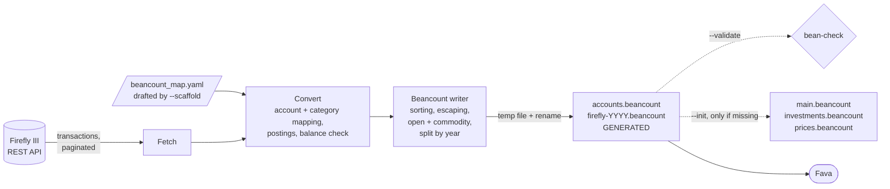
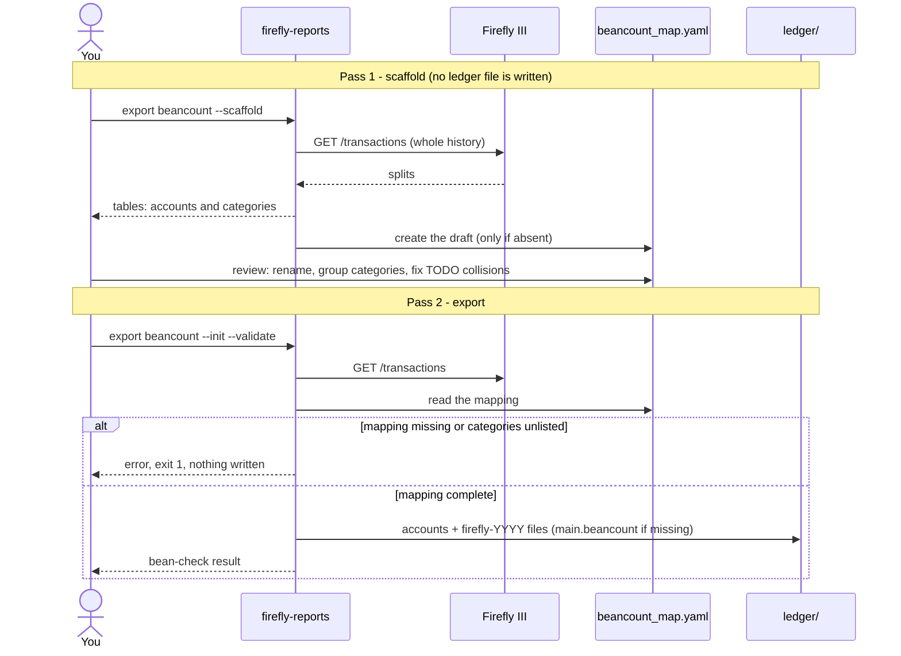
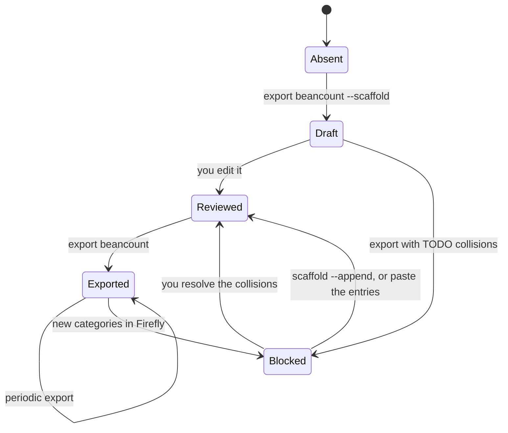
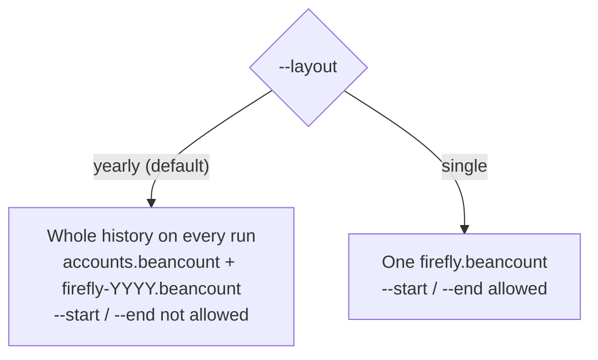
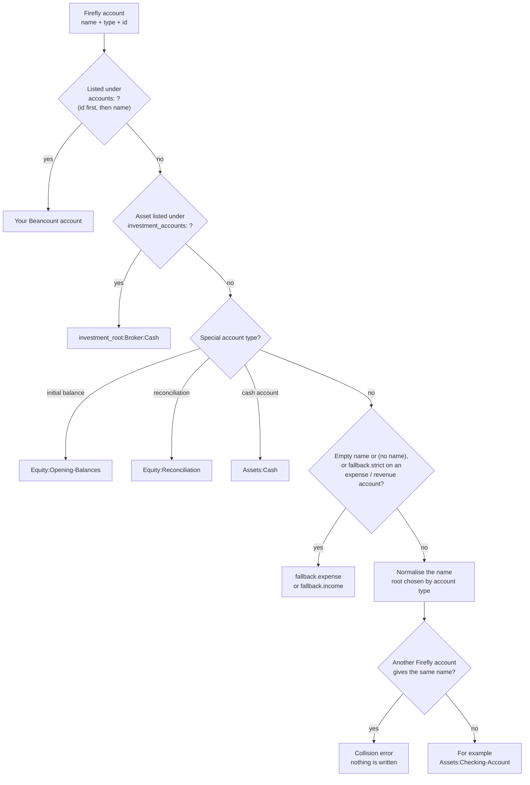
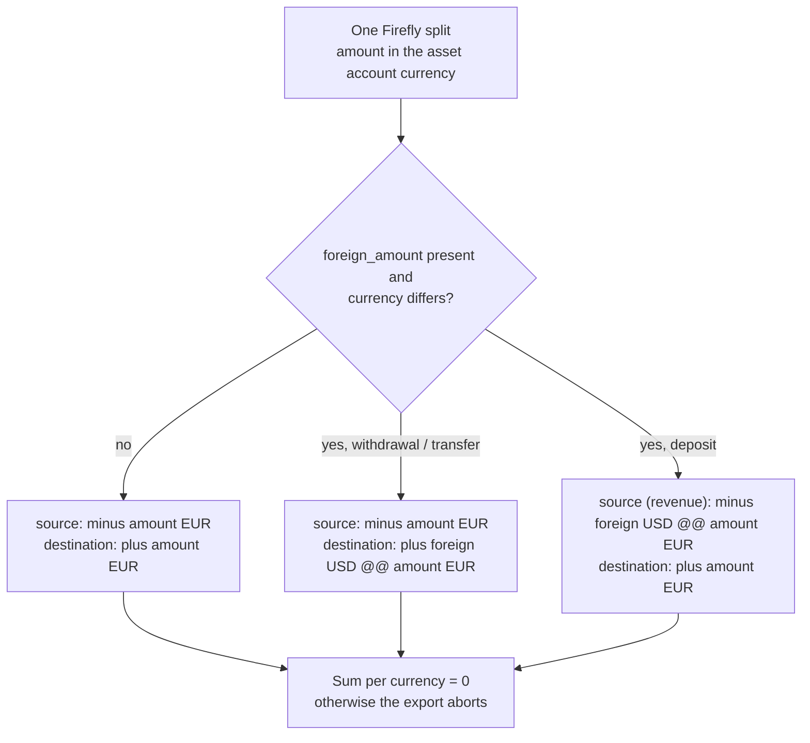
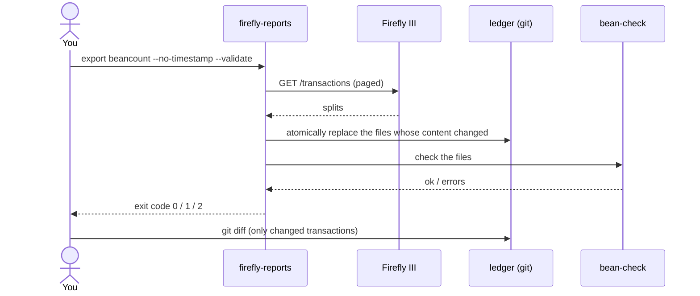
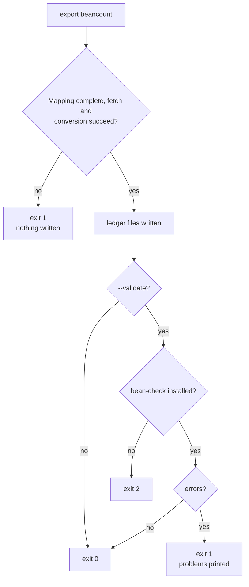

# Beancount Export

This page is the user guide of `firefly-reports export beancount`, which converts the transactions stored
in Firefly III into [Beancount](https://beancount.github.io/) v3 files that you can browse, query and audit
with [Fava](https://beancount.github.io/fava/). It covers installation, the two-pass workflow, the
options and their defaults in `firefly-reports.toml`, the mapping file, the generated files, and
troubleshooting. Developer documentation (internals, adding another format):
[[Ledger-Architecture|Ledger Architecture]].

The export uses the same credentials as the reports: `--url`/`--token`, then `firefly-reports.toml`, then
`FIREFLY_URL`/`FIREFLY_TOKEN` (or `.env`), then a prompt for the token. See [[Configuration]].

**Contents**

1. [What you get](#what-you-get)
2. [Install](#install)
3. [Step-by-step tutorial](#step-by-step-tutorial)
4. [The two passes](#the-two-passes)
5. [Layouts: yearly or single file](#layouts-yearly-or-single-file)
6. [Command reference](#command-reference)
7. [Defaults in firefly-reports.toml](#defaults-in-firefly-reportstoml)
8. [Mapping file reference](#mapping-file-reference)
9. [Example output](#example-output)
10. [Mapping rules in detail](#mapping-rules-in-detail)
11. [Recommended ledger layout](#recommended-ledger-layout)
12. [Everyday workflows](#everyday-workflows)
13. [Querying in Fava](#querying-in-fava)
14. [Languages](#languages)
15. [Exit codes](#exit-codes)
16. [Troubleshooting](#troubleshooting)
17. [Known limits](#known-limits)

---

## What you get

- By default (yearly layout) two kinds of generated files: `accounts.beancount` with the `commodity` and
  `open` directives, and one `firefly-YYYY.beancount` per calendar year with the transactions, ordered by
  date and Firefly id. `--layout single` writes one self-contained `firefly.beancount` instead.
- Expense and income accounts come from your Firefly **categories** by default (`Expenses:Groceries`,
  `Income:Salary`); the shop or customer is kept as the payee. `--classify-by account` uses the Firefly
  expense and revenue accounts instead.
- A **first pass** (`--scaffold`) that writes no ledger at all: it drafts `beancount_map.yaml`, so you can
  review how every Firefly account and category will be named before exporting anything.
- Files are **rewritten completely** on every run (never appended), each replaced atomically, and only
  when their content actually changed. Everything is converted and checked before the first file is
  written, so an error leaves your ledger untouched.
- Output is deterministic: the same Firefly data and options always give the same bytes. The
  `; Generated:` timestamp appears only in `accounts.beancount` (and in the `single` file), never in the
  per-year files, so closed years never change and `git diff` stays clean. `--no-timestamp` removes it.
- Firefly data kept as native Beancount data: payee, tags (`#tag`), linked transactions (a shared
  `^firefly-link-<id>` link), notes, budget, bill, reference and dates as metadata, and the IBAN on the
  `open` directive.
- Optionally a minimal `main.beancount` (`--init`) so Fava can open the ledger straight away.
- Cash movements only. Securities lots, prices and quantities are not in Firefly III; you keep them in a
  hand-written file that this tool never touches.

In short: the transactions are fetched from the Firefly III API (paginated), converted with your mapping
file (account and category names, postings, balance check), rendered by the Beancount writer (sorted,
escaped, split by year) and written through a temporary file and a rename. `--validate` then runs
`bean-check`, `--init` creates the starter files if missing, and Fava opens `main.beancount`.

Diagram: the whole export run at a glance (dotted arrows are optional steps).



## Install

```bash
pip install firefly-iii-reports                 # PyYAML is a regular dependency
pip install "firefly-iii-reports[beancount]"    # optional: bean-check, needed only by --validate
pip install fava                                # optional: the web UI
```

## Step-by-step tutorial

1. **Make sure credentials are configured** (see [[Configuration]]), for example:

   ```bash
   export FIREFLY_URL=https://firefly.example.com
   export FIREFLY_TOKEN=...            # or put both in .env or firefly-reports.toml
   ```

2. **Pass 1: draft the mapping** (writes no ledger file):

   ```bash
   firefly-reports export beancount --scaffold
   ```

   This fetches the whole history and prints two tables on stderr: the Firefly accounts with their
   Beancount names and origin, and the categories with their account and number of splits. It creates
   `beancount_map.yaml` **only if it does not exist**. Every automatically named account and category
   becomes an active line, so the names are frozen: renaming something in Firefly later will not silently
   change your ledger. Collisions (two accounts that would get the same name) are written as commented
   `TODO` lines.
3. **Review `beancount_map.yaml`** (the only file you edit by hand): rename accounts and categories, build
   hierarchies (`"Checking Account": "Assets:Bank:Main:Checking"`), group several categories into one
   account, resolve the `TODO` collisions, move your brokerage accounts under `investment_accounts:`. See
   the [Mapping file reference](#mapping-file-reference). `beancount_map.yaml` and `/ledger/` are already
   in the project's `.gitignore`.
4. **Pass 2: export** (writes the ledger, creates the starter files and checks the result):

   ```bash
   firefly-reports export beancount --init --validate
   ```

   This writes `ledger/accounts.beancount` and one `ledger/firefly-YYYY.beancount` per year, creates
   `main.beancount`, `investments.beancount` and `prices.beancount` **only if they do not exist**, and runs
   `bean-check`. Use `--dry-run` first if you only want to look at the output.
5. **Open it in Fava**:

   ```bash
   fava ledger/main.beancount        # http://localhost:5000
   ```

6. **Re-run the export whenever you want fresh data.** Only files whose content changed are rewritten.
   When new accounts or categories appear in Firefly, the export stops and asks you to map them (see
   [The two passes](#the-two-passes)).

## The two passes

- **Pass 1, `--scaffold`:** fetches the transactions, prints the tables and creates the draft mapping
  file if it is missing. Nothing else is written. You then review the file.
- **Pass 2, the export:** fetches the transactions again, reads the mapping and writes the ledger files
  (plus `main.beancount` with `--init`, plus the `bean-check` result with `--validate`).

The export is **blocked** (exit code `1`, nothing written) when there is no mapping file, or, with
`--classify-by category`, when the data contains categories the mapping does not list. The error lists
the missing categories with their number of splits. `--allow-unmapped` exports anyway, with automatic
names for whatever is not mapped (and a warning per category). Mapping keys that no longer appear in the
data (for example after a rename in Firefly) only produce a warning.

Diagram: the two passes between you, the tool, Firefly III, the mapping file and the ledger.



The mapping file goes through these states: absent; a draft after `--scaffold`; reviewed once you edit
it; exported by each run. A draft with unresolved `TODO` collisions, or a mapping that misses categories
that appeared in Firefly, blocks the export until you fix it (by hand, or with `--scaffold --append`).

Diagram: the life cycle of the mapping file.



When the mapping file already exists, `--scaffold` never changes it by default: it prints the accounts and
categories that are missing, ready to paste. Two options modify it:

| Option | Effect on an existing mapping file |
|---|---|
| `--scaffold --append` | Inserts the missing entries in place, keeping your lines and comments, after saving a `.bak` copy. If the file cannot be edited safely (the result would not parse, or would lose an entry) nothing is written and you are told to merge by hand |
| `--scaffold --overwrite` | Regenerates the file from scratch after you type the file name to confirm (refused when stdin is not interactive), keeping a timestamped `.bak-<timestamp>` copy |

What the scaffold writes:

| Origin | In the draft |
|---|---|
| automatic (normalised name) | active line under `accounts:` or `categories:` (frozen) |
| collision | commented line with a `TODO collision` note: the export stops until each account has its own name |
| name shared by several account types (e.g. an asset and an expense both called `Amazon`) | commented, left automatic (`accounts:` is keyed by name) |
| special (opening balance, reconciliation, cash), fallback | not listed (nothing to decide) |

It also sets `operating_currency` (the most used currency), `commodities`, `classify_by`, and adds
commented examples for `investment_accounts:` (every asset account as a candidate) and `fallback:`. With
`--dry-run` the draft goes to stdout instead of the file.

## Layouts: yearly or single file

Diagram: what each value of `--layout` produces.



- **yearly** (default): the whole history on every run, `accounts.beancount` plus one
  `firefly-YYYY.beancount` per year. Closed years never change, so periodic runs only rewrite the current
  year and the git history stays small. `accounts.beancount` holds every `open`/`commodity` once, dated at
  the first use over the whole history. Because it needs the full history, `--start`/`--end` are rejected
  in this layout (except with `--scaffold`).
- **single**: everything in `firefly.beancount`. Allows `--start`/`--end` and suits one-off or partial
  exports.

Switching layout leaves the old files in place and warns about them (see
[Troubleshooting](#troubleshooting)).

## Command reference

```text
firefly-reports export beancount [options]
```

| Option | Default | Meaning |
|---|---|---|
| `--scaffold` | off | **Pass 1.** Draft the mapping file from the accounts and categories found in Firefly; writes no ledger file. Uses `--map` as the file to create |
| `--append` | off | With `--scaffold`: add the missing entries to the existing mapping file (`.bak` copy first) |
| `--overwrite` | off | With `--scaffold`: replace the existing mapping file with a new draft, after confirmation (timestamped copy kept) |
| `--map FILE` | `./beancount_map.yaml` if present | Mapping file. An explicit `--map` that does not exist is an error, except with `--scaffold`, which creates it |
| `--classify-by category\|account` | `category` | Where expense and income accounts come from: the Firefly category, or the counterpart account |
| `--allow-unmapped` | off | Export even without a mapping file or with categories it does not list yet |
| `--layout yearly\|single` | `yearly` | `yearly`: `accounts.beancount` + `firefly-YYYY.beancount`; `single`: one `firefly.beancount` |
| `--start YYYY-MM-DD` | all | Earliest transaction date. Only with `--layout single` (or `--scaffold`) |
| `--end YYYY-MM-DD` | all | Latest transaction date. With neither bound the whole history is exported |
| `--out DIR` | `ledger` | Output **directory** (created if needed) |
| `--dry-run` | off | Print to stdout, write nothing. With several files each one is preceded by a `; ===== name =====` line. `--init` is ignored. Messages go to stderr, so stdout only contains the ledger |
| `--validate` | off | Run `bean-check` and print the problems readably. Single layout: the generated file. Yearly: a temporary file that includes `accounts.beancount` and every year (not your `main.beancount`). With `--dry-run` temporary copies are checked |
| `--init` | off | Create `main.beancount` and empty `investments.beancount` / `prices.beancount` in the output directory **if missing** |
| `--no-timestamp` | off | Omit the `; Generated:` line: byte-identical reruns |
| `--lang en\|it` | from the config file, `FIREFLY_LANG`, or `en` | Language of metadata keys, header, default fallback and investment accounts, and messages |
| `--url`, `--token` | from the credential chain | As for `report`. Global options can be given before or after `export` |

`--out`, `--layout`, `--classify-by` and `--map` can also be set in `firefly-reports.toml` (next section).

Date filters are passed to the Firefly III API (`/api/v1/transactions`). The tool never deletes files:
obsolete generated files (for example a year that no longer has transactions) are only reported.

## Defaults in firefly-reports.toml

The `[export]` section of `firefly-reports.toml` gives defaults to the export, so the same file can drive
both `report` and `export`. A flag on the command line always wins, then the config file, then the
built-in default:

```toml
[export]
out         = "./ledger"             # default: ledger
layout      = "yearly"               # yearly | single (default: yearly)
classify_by = "category"             # category | account (default: category)
map         = "beancount_map.yaml"   # default: ./beancount_map.yaml if present
```

The top-level `out` key of the config file is the output directory of `report` only; the ledger uses
`[export] out`. `[export] classify_by` (and `--classify-by`) override the `classify_by` key of the mapping
file. An invalid `layout` or `classify_by` value stops the command with a configuration error.

## Mapping file reference

`beancount_map.yaml` is required for an export (unless `--allow-unmapped`), but every section in it is
optional; `--scaffold` drafts it for you. Unknown keys are rejected so typos are not silently ignored.
An annotated example ships as `beancount_map.example.yaml`.

```yaml
classify_by: category

accounts:
  "Checking Account": "Assets:Bank:Main:Checking"
  "12": "Assets:Bank:Main:Savings"                 # numeric Firefly id also works
  "Home Mortgage": "Liabilities:Mortgage"

categories:
  expense:
    "Restaurants": "Expenses:Leisure:Restaurants"
    "Groceries": "Expenses:Home:Groceries"
    "Home": "Expenses:Home:Groceries"              # several categories may share one account
  income:
    "Fees": "Income:Work"

investment_accounts:
  "Acme Investments": "Acme"

investment_root: "Assets:Investments"

fallback:
  expense: "Expenses:Uncategorized"
  income: "Income:Uncategorized"
  strict: false

operating_currency: [EUR]
commodities: [EUR, USD]

labels:
  category: category
  budget: budget
  note: note
```

| Key | Type | Details |
|---|---|---|
| `classify_by` | `category` or `account` | Where expense and income accounts come from. Default `category`. Overridden by `--classify-by` and `[export] classify_by` |
| `accounts` | map | Firefly account **numeric id or name** -> Beancount account. Highest precedence: an entry matching the account **id** wins over one matching the **name** (ids are unique, names can be shared by account types). Many-to-one is allowed. Values must look like `Assets:Foo-Bar`: root one of `Assets Liabilities Equity Income Expenses`, components start with an uppercase letter or digit and contain only letters, digits and `-`. A name mapping that lands in a root different from the one expected for the account type is kept, with a warning |
| `categories.expense`, `categories.income` | map | Firefly category -> Beancount account, one map per direction (a category used both for spending and for income appears in both). Expense values must start with `Expenses:`, income values with `Income:`. Used when classifying by category |
| `investment_accounts` | map | Firefly **asset** account (name or id) -> broker name. Becomes `<investment_root>:<Broker>:Cash`; the broker is normalised (`"Grüne Bank"` -> `Grune-Bank`). Several Firefly accounts may share a broker |
| `investment_root` | account | Default depends on `--lang`: `Assets:Investments` (en), `Assets:Investimenti` (it) |
| `fallback.expense` / `fallback.income` | account | Target for counterparts and categories with an empty or placeholder name. Defaults follow `--lang`: `Expenses:Uncategorized` / `Income:Uncategorized` (en), `Expenses:Non-Classificato` / `Income:Non-Classificato` (it) |
| `fallback.strict` | bool | `true`: every expense/revenue account or category **not** listed goes to the fallback instead of being auto-named. Asset and liability accounts are never affected |
| `operating_currency` | list | Written as `option "operating_currency"` in the `main.beancount` created by `--init`. Default: the most used currency |
| `commodities` | list | Extra `commodity` directives for currencies no transaction uses yet. Used currencies are always declared |
| `labels` | map | Force the metadata key names for `category`, `budget`, `note`, independent of `--lang`. Keys must match `[a-z][a-zA-Z0-9_-]*` and must not clash with the fixed keys |

Resolution order for an account: `accounts` (numeric id first, then name) -> `investment_accounts` ->
special accounts (initial balance -> `Equity:Opening-Balances`, reconciliation -> `Equity:Reconciliation`,
cash account -> `Assets:Cash`) -> fallback (empty or `(no name)` name, or strict mode on an
expense/revenue account) -> automatic normalisation under the root of the account type. The first rule
that matches wins. If an automatically generated name equals the name of another Firefly account, the
export stops with a collision error and writes nothing. For a category: the `categories` entry of its
direction -> fallback (no category, or strict mode) -> automatic `Expenses:<Name>` or `Income:<Name>`.

Diagram: how a Firefly account gets its Beancount name (the first rule that matches wins).



## Example output

Input data (simplified, from the same fixture that pins the export tests,
`tests/fixtures/firefly_transactions.json`):

| id | type | date | amount | from -> to | notes |
|---|---|---|---|---|---|
| 3 | withdrawal | 2025-01-20 | 42.50 EUR | Checking Account -> Café Münch & Söhne | description `Dinner "with friends"`, category Restaurants, budget Leisure |
| 5 (group, 3 splits) | withdrawal | 2025-02-08 | 30.00 + 12.40 + 7.10 EUR | Checking Account -> Green Supermarket / City Pharmacy | group title `Saturday shopping` |
| 8 | withdrawal | 2025-03-03 | 91.75 EUR | Checking Account -> Hotel Lisboa | foreign amount 100.00 USD |
| 9 | deposit | 2025-03-10 | 184.20 EUR | Freelance USA Inc -> Checking Account | foreign amount 200.00 USD |
| 10 | transfer | 2025-03-15 | 1000.00 EUR | Checking Account -> Acme Investments | reconciled |

Generated with `--lang en` on that data (no mapping file, so `--allow-unmapped`
gives every account its automatic name):

```
firefly-reports export beancount --layout single --no-timestamp --allow-unmapped --lang en
```

`firefly.beancount` (the real output of the command above, pasted unedited):

```beancount
; GENERATED - DO NOT EDIT BY HAND

2024-12-31 commodity EUR
2025-03-03 commodity USD

2025-03-15 open Assets:Acme-Investments
2025-04-05 open Assets:Cash
2024-12-31 open Assets:Checking-Account
2025-02-01 open Assets:Savings-Emergency-Fund
2024-12-31 open Equity:Opening-Balances
2025-03-31 open Equity:Reconciliation
2025-02-08 open Expenses:Groceries
2025-02-08 open Expenses:Health
2025-02-08 open Expenses:Home
2025-01-20 open Expenses:Restaurants
2025-03-03 open Expenses:Travel
2025-04-02 open Expenses:Uncategorized
2025-01-15 open Income:Fees
2025-04-10 open Liabilities:Home-Mortgage

2024-12-31 * "Opening balance for Checking Account"
  firefly_id: "1"
  Equity:Opening-Balances        -1500.00 EUR
  Assets:Checking-Account         1500.00 EUR

2025-01-15 * "Acme Consulting LLC" "Invoice #001" #invoice #taxes-2025
  firefly_id: "2"
  Income:Fees                    -3200.00 EUR
  Assets:Checking-Account         3200.00 EUR

2025-01-20 * "Café Münch & Söhne" "Dinner \"with friends\""
  firefly_id: "3"
  budget: "Leisure"
  note: "Line one Line two with \\ backslash"
  Assets:Checking-Account          -42.50 EUR
  Expenses:Restaurants              42.50 EUR

2025-02-01 * "Savings transfer"
  firefly_id: "4"
  Assets:Checking-Account         -500.00 EUR
  Assets:Savings-Emergency-Fund    500.00 EUR

2025-02-08 * "Saturday shopping"
  firefly_id: "5"
  firefly_group_id: "5"
  Assets:Checking-Account          -49.50 EUR
  Expenses:Groceries                30.00 EUR
    payee: "Green Supermarket"
    budget: "Home"
  Expenses:Home                     12.40 EUR
    payee: "Green Supermarket"
    budget: "Home"
  Expenses:Health                    7.10 EUR
    payee: "City Pharmacy"

2025-03-03 * "Hotel Lisboa" "Hotel in Lisbon"
  firefly_id: "8"
  Assets:Checking-Account          -91.75 EUR
  Expenses:Travel                  100.00 USD @@ 91.75 EUR

2025-03-10 * "Freelance USA Inc" "Consulting"
  firefly_id: "9"
  Income:Fees                     -200.00 USD @@ 184.20 EUR
  Assets:Checking-Account          184.20 EUR

2025-03-15 * "Broker deposit"
  firefly_id: "10"
  Assets:Checking-Account        -1000.00 EUR
  Assets:Acme-Investments         1000.00 EUR

2025-03-31 * "Reconciliation"
  firefly_id: "11"
  Equity:Reconciliation             -2.35 EUR
  Assets:Checking-Account            2.35 EUR

2025-04-02 * "Expense without payee"
  firefly_id: "12"
  Assets:Checking-Account           -9.99 EUR
  Expenses:Uncategorized             9.99 EUR

2025-04-05 * "Cash withdrawal"
  firefly_id: "13"
  Assets:Checking-Account          -60.00 EUR
  Assets:Cash                       60.00 EUR

2025-04-10 * "Home Loan Bank" "Installment"
  firefly_id: "14"
  Liabilities:Home-Mortgage       -250.00 EUR
  Expenses:Uncategorized           250.00 EUR
```

## Mapping rules in detail

**Postings.** For every split the destination account gets `+amount` and the source account `-amount`,
whatever the transaction type (withdrawal, deposit, transfer, opening balance, reconciliation). When
classifying by category and exactly one side of the split is an expense or revenue account, that side is
replaced by the category account. A group with N splits becomes **one** Beancount transaction; postings
that hit the same account and currency without extra metadata are summed (the shared source in the
example). Every transaction is checked to balance per currency before it is written; an unbalanced one
aborts the export.

**Transfers.** A transfer between two of your accounts never touches an expense or income account; its
category, if any, is kept as metadata.

**Amounts.** Firefly amount strings are parsed straight into `Decimal`; floats are never used. Decimals
are preserved as delivered (`42.50`, `0.00012345`), never in scientific notation. Currency codes are
upper-cased.

**Foreign amounts.** In Firefly, `amount` is in the asset account's currency and `foreign_amount` belongs
to the counterpart. The counterpart posting is written in the foreign currency with a **total** price
(`@@`) equal to `amount`, so the transaction balances exactly with no rounded unit price. For withdrawals
and transfers that is the destination posting; for deposits it is the revenue (source) posting. A foreign
currency equal to the base currency is ignored.

Diagram: which posting carries the foreign amount, by transaction type.



**Header.** The date is the split `date` (the earliest one in a multi-split group). The flag is always `*`.
The payee is the expense/revenue counterpart when all splits share one (not for transfers, not for
`(no name)`/`(cash)`); otherwise each posting carries its own `payee` metadata. The narration is the
description (for a multi-split group the group title, or the descriptions joined with `; ` if there is no
title). Firefly tags become `#tags` (characters Beancount does not allow become `-`); linked transactions
share a `^firefly-link-<id>` link. Quotes, backslashes and line breaks in strings are escaped or
flattened.

**Metadata.**

| Key | Where | Language |
|---|---|---|
| `firefly_id` | every transaction (journal id of the first split) | fixed |
| `firefly_group_id` | multi-split groups | fixed |
| category / budget / note (`category`, `budget`, `note` in English; `categoria`, `budget`, `nota` in Italian) | on the transaction when all splits agree, otherwise on the posting of each split. The category appears as metadata only when it is not already the account (transfers, or `--classify-by account`) | translated, overridable with `labels:` |
| `payee` | on postings, when the splits of a group have different counterparts | fixed |
| `bill`, `reference`, `external_id`, `external_url`, `book_date`, `interest_date` | when set in Firefly; on the transaction when all splits agree | fixed |
| `iban` | on the `open` directive of an account with an IBAN | fixed |

**Account names.** Roots by Firefly account type: asset -> `Assets`, expense -> `Expenses`, revenue ->
`Income`, loan/debt/mortgage -> `Liabilities`, initial balance -> `Equity:Opening-Balances`,
reconciliation -> `Equity:Reconciliation`, cash account -> `Assets:Cash`. A name becomes one component:
accents are transliterated (`è` -> `e`, `ß` -> `ss`, `ø` -> `o`), every run of other characters becomes a
single `-`, and the first letter is capitalised. To build hierarchies use explicit entries.

**Collisions.** If two **different** Firefly accounts end up with the same automatic name (for example
`Account A` and `Account-A`), the export stops with an error listing both and writes nothing. Mapping several
accounts or categories to one name *explicitly* is allowed.

**Directives.** `commodity` for every currency used (as amount or price) and `open` for every account,
dated at the first transaction that uses it over the whole history, come before the transactions (yearly
layout: all of them in `accounts.beancount`). Accounts are not currency-constrained.

## Recommended ledger layout

```text
ledger/
  main.beancount          # options + includes - yours, created once by --init
  accounts.beancount      # GENERATED - commodity + open directives
  firefly-2024.beancount  # GENERATED - one file per year
  firefly-2025.beancount  # GENERATED
  investments.beancount   # yours: securities buys/sells, balance assertions
  prices.beancount        # yours (or fed by a price fetcher)
```

The generated files are rewritten only when their content changes; your files are never overwritten.
`main.beancount` includes `accounts.beancount`, all `firefly-*.beancount` files through a glob (so a new
year needs no edit), `investments.beancount` and `prices.beancount`; Fava opens `main.beancount`. With
`--layout single` the generated part is just `firefly.beancount`.

Diagram: generated and hand-written files and the includes of `main.beancount`.


`main.beancount` as created by `--init` (yearly layout, English):

```beancount
; Minimal main file created by firefly-reports. Edit freely: it is never overwritten.
option "title" "Ledger generated from Firefly III"
option "operating_currency" "EUR"
1970-01-01 custom "fava-option" "language" "en"

include "accounts.beancount"
include "firefly-*.beancount"
include "investments.beancount"
include "prices.beancount"
```

The `custom "fava-option" "language"` line sets Fava's interface language to the output language
(Beancount itself rejects unknown `option` lines).

Safety rules enforced by the tool: it never overwrites an existing `main.beancount`,
`investments.beancount` or `prices.beancount`; the only files it replaces are its own generated files
(`accounts.beancount`, `firefly-YYYY.beancount`, `firefly.beancount`) inside `--out`, and it never deletes
anything. An empty result (no transactions) writes nothing.

Investment workflow: move money to the broker in Firefly (a transfer to the investment account) and map
that account under `investment_accounts:`. The export credits `<investment_root>:<Broker>:Cash`. In
`investments.beancount` you then record the purchase by hand:

```beancount
2025-03-16 * "Buy VWCE"
  Assets:Investments:Acme:VWCE   8 VWCE {118.50 EUR}
  Assets:Investments:Acme:Cash  -948.00 EUR
```

## Everyday workflows

A periodic run fetches the transactions, replaces only the files whose content changed, runs
`bean-check` and returns its exit code; `git diff` then shows only the changed transactions.

Diagram: a periodic export versioned in git.



- **Full refresh, versioned in git** (recommended):

  ```bash
  firefly-reports export beancount --no-timestamp --validate && git -C ledger diff --stat
  ```

  Only genuinely changed transactions show up in the diff, and in the yearly layout only the affected
  years' files. Corrections made in Firefly to an old year are picked up because every run is a full
  export.
- **New accounts or categories in Firefly**: the export stops on unmapped categories. Run
  `firefly-reports export beancount --scaffold` to list what is missing, then either paste the entries
  into the mapping file or let `--scaffold --append` insert them. Unlisted accounts are exported with an
  automatic name.
- **Cron**: `0 6 * * * cd /srv/ledger && firefly-reports export beancount --no-timestamp --validate >> export.log 2>&1`
  (credentials from the environment, `.env` or `firefly-reports.toml` in that directory).
- **Pipe to another tool**: `firefly-reports export beancount --layout single --dry-run --no-timestamp > /tmp/f.beancount`
  (stdout only contains the ledger).

## Querying in Fava

Use the Query tab (or `bean-query`). By category, the expense accounts already are the categories;
`firefly_id` lets you jump back to Firefly III.

```sql
-- spending by expense account (= category)
SELECT account, sum(position) WHERE account ~ '^Expenses' GROUP BY account ORDER BY account

-- find a transaction by its Firefly id
SELECT date, narration, account, position WHERE entry_meta('firefly_id') = '8'

-- spending by payee
SELECT payee, sum(position) WHERE account ~ '^Expenses' GROUP BY payee ORDER BY payee
```

## Languages

Everything user-facing comes from `translations/en.toml` and `it.toml` (section `[ledger]`): metadata
keys, header text, default fallback and investment account names, `--init` file comments and all
messages. Technical identifiers (`firefly_id`, `firefly_group_id`, the fixed keys, the Beancount root
names) are the same in every language. Switching `--lang` renames the metadata keys in the generated files,
which produces one large diff; pin them with `labels:` if you have saved Fava queries or want stable files.

## Exit codes

Diagram: how a run ends, and with which exit code.



| Code | Meaning |
|---|---|
| `0` | Success (and `bean-check` clean when `--validate` is used) |
| `1` | Nothing written or a problem found: missing mapping file or unmapped categories (without `--allow-unmapped`), invalid mapping or options, account collision, unparsable or unbalanced transaction, no transactions, request to Firefly III failed, `--overwrite` not confirmed, or `bean-check` reported errors |
| `2` | `--validate` requested but `bean-check` is not installed, or invalid command-line usage |

## Troubleshooting

| Symptom | Cause / fix |
|---|---|
| `No mapping file found (expected ./beancount_map.yaml)` | Run the first pass with `--scaffold`, review the file, then export again; or pass `--allow-unmapped` |
| `The mapping file does not list these categories: ...` | New categories in Firefly. Add them with `--scaffold --append` (or `--scaffold` to see them), or pass `--allow-unmapped` |
| `Mapping file not found: X` | An explicit `--map` (or `[export] map`) points to a missing file |
| `Account name collision ...` | Two Firefly accounts normalise to the same name. Give each its own entry under `accounts:` (or rename one in Firefly) |
| Export stops with a collision after `--scaffold` | The `TODO collision` lines are commented out on purpose: uncomment them and give each account its own name |
| `Unknown key 'x' in the mapping file` | Typo or unsupported key; the message lists the allowed keys |
| `Invalid Beancount account 'x' for 'y'` | The value does not match `Root:Component:...` (root one of Assets/Liabilities/Equity/Income/Expenses, components starting with an uppercase letter or digit) |
| `Transaction N: invalid amount/date/missing currency` | The Firefly record is malformed; fix it in Firefly III (N is the journal id) |
| `--start/--end cannot be used with the yearly layout` | The yearly layout always exports the whole history. Drop the dates, or use `--layout single` for a partial export |
| `Not produced in this run and left untouched: ...` | Files from a previous run (another layout, or a year without transactions) are still in the output directory. Delete them if obsolete; if `main.beancount` still includes a stale `firefly.beancount` next to the yearly files, transactions are counted twice |
| `bean-check not found` | `pip install "firefly-iii-reports[beancount]"` or `pip install beancount` |
| `bean-check found N problem(s)` | The blocks printed are bean-check's own. The generated files alone are validated; check your hand-written files with `bean-check ledger/main.beancount` |
| `Account X is not open` in bean-check | A hand-written file uses an account that no file opens; add an `open` directive in your own file |
| Duplicate `open` error | The same account is opened in two files: do not mix `firefly.beancount` (single) with `accounts.beancount` (yearly) |
| Fava shows nothing or wrong dates | Open `main.beancount`, not one of the generated files; check `--start/--end` (single layout) |
| `Request to Firefly III failed` | Same causes as in [[Troubleshooting]] (token, URL, network) |
| Metadata keys changed language | You changed `--lang`; pin them with `labels:` |

## Known limits

- No securities lots, quantities, prices or `balance` assertions (Firefly III does not have them).
- Reconciliations and opening balances become plain `Equity` postings.
- Foreign amount placement relies on Firefly's convention that `amount` is in the asset account's currency.
- One date per transaction: in a group whose splits have different dates the earliest wins.
- Piggy banks, budget limits, bills (other than the `bill` metadata) and recurring transactions are not
  exported.
- The only filters are `--start` and `--end` (single layout); there is no per-account, per-tag or
  per-category filter.
- Every run fetches the whole history in the yearly layout (unchanged years are simply not rewritten).
- The set of files is not replaced atomically as a group (each file is); conversion errors happen before
  any write.
- `--validate` checks the generated files alone, not your whole `main.beancount`.
- The whole result set is held in memory.
