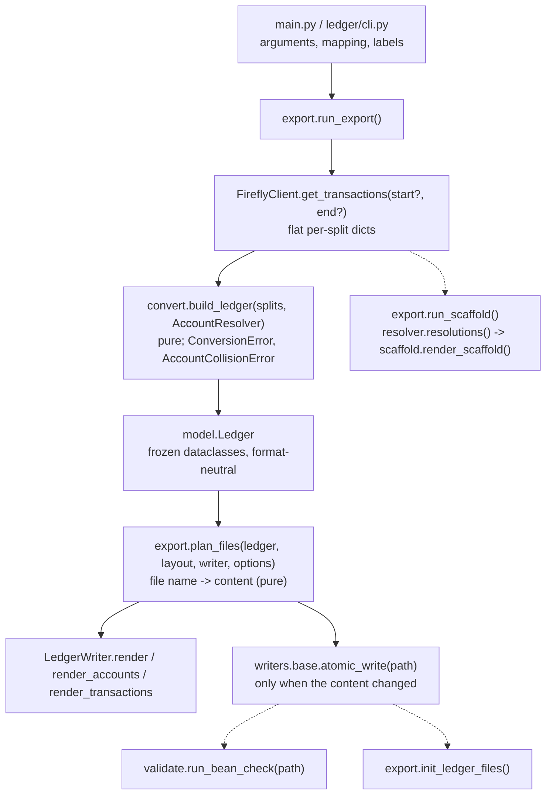
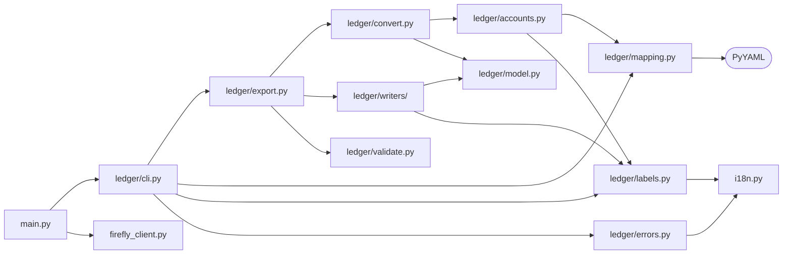
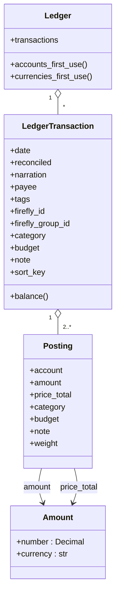
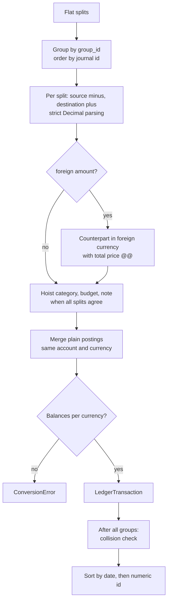
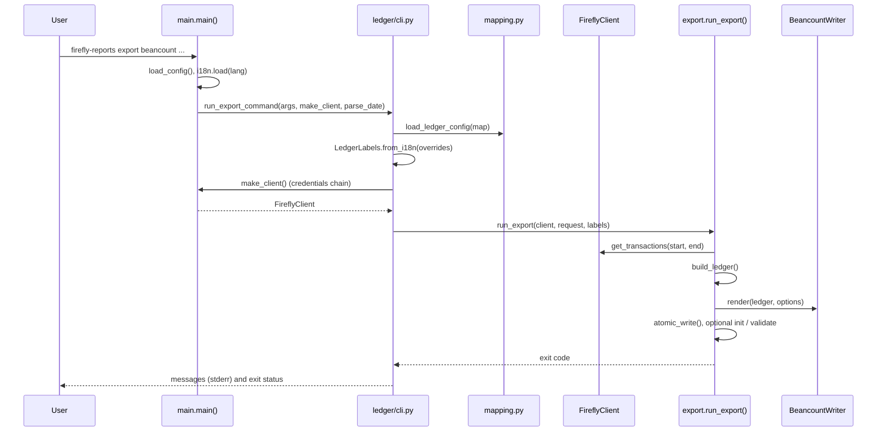
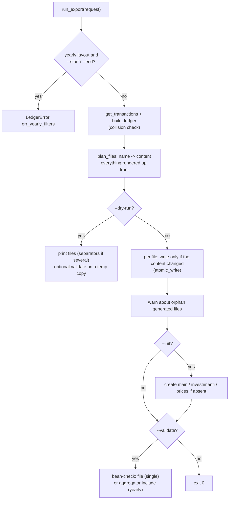

# Ledger Architecture (developer guide)

How the plain-text-accounting export (`firefly_reports/ledger/`) is built, which guarantees it gives, and how
to add a new output format such as hledger. User documentation: [[Beancount-Export|Beancount Export]].

## Goals and non-goals

* Reuse the existing client, credentials and i18n; add no network code outside `firefly_client.py`.
* Separate **fetch -> neutral model -> writer** so a new format is a new writer only.
* Money is `Decimal` end to end; mapping and normalisation are testable without the network.
* Deterministic output and atomic writes.
* Non-goal: generating investment positions (the data does not exist in Firefly III).

## Data flow



The scaffold (`--scaffold`) shares the fetch and the conversion but stops before the writers: it builds the
ledger with `check_collisions=False` so that clashes are reported in the YAML instead of aborting.

`export.run_export()` wires these steps; `ledger/cli.run_export_command()` loads the mapping and labels and
turns exceptions into exit codes; `main.cmd_export()` is a thin adapter that supplies credentials and the client.

## Module map




| Module | Responsibility | Depends on |
|---|---|---|
| `ledger/model.py` | `Amount`, `Posting`, `LedgerTransaction`, `Ledger`; balance and first-use helpers | stdlib |
| `ledger/errors.py` | `LedgerError(message_key, **params)` and subclasses; message rendered lazily via `i18n.t` | `i18n` |
| `ledger/labels.py` | `LedgerLabels`: translatable strings + validation of metadata keys | `i18n`, `errors` |
| `ledger/mapping.py` | `LedgerConfig`, `parse_ledger_config()`, `load_ledger_config()` (PyYAML) | `errors`, `labels` |
| `ledger/accounts.py` | `normalize_component()`, `classify()`, `AccountResolver` (precedence, collisions) | `config`, `labels`, `errors` |
| `ledger/convert.py` | Firefly split -> `LedgerTransaction`; grouping, foreign amounts, merging, balance check | `accounts`, `model`, `errors` |
| `ledger/writers/base.py` | `LedgerWriter` protocol, `WriterOptions`, `atomic_write()` | `labels`, `model` |
| `ledger/writers/beancount.py` | `BeancountWriter`, `quote()`, `format_number()` | `writers.base`, `model` |
| `ledger/validate.py` | optional `bean-check` runner (`shutil.which` + `subprocess`, argv list, no shell) | stdlib |
| `ledger/cli.py` | `add_export_parser()` (argparse `export <format>`) and `run_export_command()` (mapping lookup, labels, exit codes); credentials/client and date parsing are injected by `main.py` | `export`, `mapping`, `labels`, `errors` |
| `ledger/scaffold.py` | `render_scaffold()`, `render_new_accounts()`, `render_table()`: draft of `beancount_map.yaml` from `Resolution` records (pure, templated text so comments survive) | `accounts`, `i18n` |
| `ledger/export.py` | `ExportRequest`, `plan_files()` (layouts), `run_export()`, `run_scaffold()`, `--init` file creation, orphan detection, validation | all of the above |

Rules: `model`, `convert`, `accounts` and the writers do no I/O (only `atomic_write`, `validate`, `config.load_*`
and `export` touch the disk or processes); writers never call `i18n`, they receive a `LedgerLabels`.

## The neutral model




* `Amount(number: Decimal, currency: str)`.
* `Posting(account, amount, price_total=None, category=None, budget=None, note=None)`. `price_total` is a
  *total* price (Beancount `@@`). `Posting.weight` is the amount that counts for balancing: the price total
  (signed like the units) when present, otherwise the amount.
* `LedgerTransaction(date, reconciled, narration, postings, firefly_id, firefly_group_id, payee, tags,
  category, budget, note)`. `sort_key` is `(date, numeric id, id string)`. `balance()` returns the residual
  per currency (all zeros for a valid transaction).
* `Ledger(transactions)` with `accounts_first_use()` and `currencies_first_use()` (both sorted).

The model carries semantics (`reconciled`, `category`) not syntax (`*`, `categoria:`): flag characters, metadata
key names and quoting belong to the writer and its labels.

## Conversion algorithm (`convert.py`)




1. **Group** flat splits by `group_id` (fallback: journal id). Splits are ordered by numeric journal id.
2. **Pair postings** for each split (`_split_postings`): source `-amount`, destination `+amount`, both in
   `currency_code`. Amounts go through a strict `Decimal(str(x))` parser; `NaN`, `Infinity`, empty or invalid
   values raise `ConversionError` (no silent zero). `_negate` avoids `-0.00`.
3. **Foreign amount**: if `foreign_currency_code` differs from the base currency and `foreign_amount` is
   non-zero, the counterpart posting is expressed in the foreign currency with
   `price_total = |amount| in base currency`. Counterpart = source for `deposit`, destination otherwise.
4. **Uniform metadata**: for category, budget and note, if every split agrees the value is hoisted to the
   transaction and removed from the postings; otherwise it stays on each destination posting.
5. **Narration / payee / tags / flag / date**: see the user page; payee is set only when all splits share one
   non-placeholder counterpart; date is the minimum split date; `reconciled` requires all splits reconciled.
6. **Merge** (`_merge_postings`): postings with the same account and currency, no price and no metadata are
   summed, preserving first-seen order.
7. **Balance check**: `tx.balance()` must be all zeros or `ConversionError("ledger.err_unbalanced")`.
8. After all groups, `AccountResolver.raise_on_collisions()` then a stable sort by `sort_key`.

## Account resolution (`accounts.py`)

`AccountResolver.resolve(name, firefly_type, account_id, side)`:

1. `classify()` maps the Firefly account type string (`"Asset account"`, `"Expense account"`, `"Loan"`,
   `"Initial balance account"`, ...) to a kind; unknown types fall back to `expense` for destinations and
   `income` for sources.
2. Precedence: explicit `accounts` (by name or id) -> `investment_accounts` (asset kind only) -> opening /
   reconciliation / cash specials -> fallback (strict mode or empty/`(no name)`) -> `normalize_component()`.
3. Every result is recorded as `ledger account -> {(kind, firefly name): explicit?}`. A collision is a ledger
   account with more than one identity where at least one was **automatically** generated. Explicit many-to-one
   mapping is intentional and never reported.
4. Each decision is also stored as a `Resolution(name, firefly_type, kind, account, origin)`, origin being
   `explicit`, `investment`, `special`, `fallback` or `auto`. `resolutions()` feeds the scaffold and its table.

`normalize_component()`: transliterate letters NFKD cannot decompose (`ß ø æ œ đ ł`), NFKD + drop combining
marks, replace runs of `[^A-Za-z0-9]` by `-`, strip dashes, capitalise the first letter.

## Writer contract and the Beancount writer

```python
class LedgerWriter(Protocol):
    extension: str                                                      # ".beancount"
    def render(self, ledger, options) -> str: ...               # self-contained single file
    def render_accounts(self, ledger, options) -> str: ...      # commodity + open only
    def render_transactions(self, ledger, options) -> str: ...  # transactions only

@dataclass(frozen=True)
class WriterOptions:
    labels: LedgerLabels
    commodities: tuple[str, ...] = ()
    generated_at: datetime | None = None   # None -> no timestamp line
```

Every method returns a complete file (header included). `BeancountWriter.render()` is
`render_accounts()` + `render_transactions()` under one header: `commodity` directives, `open` directives, then each
transaction. Number alignment uses **per-file** column widths (deterministic, and a long new account name does
not rewrite closed years). Strings go through `quote()`
(escapes `\` and `"`, flattens newlines). Numbers go through `format_number()` (`format(d, "f")`: positional,
decimals preserved).

The `; Generated:` timestamp is written only where a rerun is expected to rewrite the file anyway:
`render_accounts()` and the single-file `render()`. `render_transactions()` (the per-year files) never carries it,
so unchanged years stay byte-identical and are not rewritten.

Determinism checklist for any writer: iterate only over sorted structures, never over `dict`/`set` order you did
not build deterministically, no locale-dependent formatting, no environment-dependent data except the optional
timestamp.

## i18n design

* Strings live under `[ledger]` in both `translations/en.toml` and `it.toml` (keys must match).
* `LedgerLabels.from_i18n(overrides)` snapshots the active language into an immutable object. Metadata keys are
  validated against `[a-z][a-zA-Z0-9_-]*` (a translation with an accented or capitalised key fails loudly, and a
  test checks both languages).
* Errors store a message key and parameters; `str(exc)` translates at display time. Add a key to **both** TOML
  files whenever you add a message.
* Technical keys (`firefly_id`, `firefly_group_id`) are constants of `LedgerLabels` and not translated.

## Config and CLI wiring




* `ledger.cli.add_export_parser()` (called from `main.parse_args()`) registers `export <format>`; shared options (`--url --token --start --end --lang
  --out`) use `argparse.SUPPRESS` so values given before the subcommand are kept (argparse otherwise lets
  subparser defaults overwrite them).
* `main()` dispatches `export` right after `init` and before the `--year/--start/--end` report validation.
* `ledger.cli.run_export_command()` resolves the mapping path (`--map` > `./beancount_map.yaml`), builds labels,
  calls the injected `make_client()` (`main.cmd_export` builds it with the existing `_resolve_credentials()` and
  `FireflyClient`, so `ledger.cli` never imports `main`), and maps `LedgerError` / `requests.RequestException`
  to exit code 1.
* `FireflyClient.get_transactions(start=None, end=None, tx_type=None)`: omitted bounds are not sent.

## `run_export` step by step



## Safety properties

* `atomic_write()`: temp file in the target directory, `os.replace`, mode of an existing target preserved
  (default 0644), temp file removed on failure. The previous file survives any error.
* `--init` creates `main.beancount` / `investimenti.beancount` / `prices.beancount` only when absent.
* `run_export` renders **every** file before writing the first one; unchanged files are not rewritten; files it did
  not produce are only reported (`find_orphans`), never deleted.
* The scaffold never writes into an existing mapping file.
* `validate.run_bean_check()` uses an argv list and the path from `shutil.which`; no shell.
* No tokens are written to any output or log by this code path.

## Adding a new format (hledger example)

1. Create `firefly_reports/ledger/writers/hledger.py`:
   ```python
   class HledgerWriter:
       def render(self, ledger: Ledger, options: WriterOptions) -> str:
           lines = [f"; {options.labels.header_notice}"]
           for tx in ledger.transactions:
               flag = "*" if tx.reconciled else "!"
               lines.append(f"{tx.date:%Y-%m-%d} {flag} {tx.payee or ''} | {tx.narration}")
               for p in tx.postings:
                   lines.append(f"    {p.account}  {p.amount.number} {p.amount.currency}"
                                + (f" @@ {p.price_total.number} {p.price_total.currency}" if p.price_total else ""))
           return "\n".join(lines) + "\n"
   ```
   (Illustrative only: hledger has different account-name rules, so also add its own normaliser or a
   `style` switch in `AccountResolver`, and its own escaping.)
2. Export it in `writers/__init__.py`.
3. Extend `FORMATS` in `ledger/cli.py` and select the writer in `run_export_command()` (pass it to
   `run_export(..., writer=HledgerWriter())`; `run_export` already accepts any `LedgerWriter`).
4. Add tests: unit tests for the writer, a determinism test, and an integration test guarded by
   `shutil.which("hledger")`.
5. Update the user page, README, CHANGELOG and AGENTS.md table.

`convert.py`, `model.py` and the Firefly client need no change. If the new format needs different account
rules, make them a parameter of `AccountResolver` rather than forking it.

## Tests

| File | Covers |
|---|---|
| `tests/test_ledger.py` | normalisation, resolver precedence and collisions, mapping validation, conversion (all transaction types, splits, foreign amounts), writer text/escaping/determinism, atomic write, i18n, export orchestration, `bean-check` integration |
| `tests/test_ledger_cli.py` | argument parsing, defaults, `--dry-run`, `--init`, mapping/language selection, error exits |
| `tests/test_ledger_layout.py` | yearly vs single layout (partition, determinism, no-op reruns, orphans), `bean-check` with the glob include, scaffold (draft validity, collisions, ambiguous names, existing mapping untouched), two-pass CLI flow |
| `tests/test_firefly_client.py` | optional `start`/`end` in `get_transactions` |
| `tests/fixtures/firefly_transactions.json` | API-shaped payload: opening balance, deposit, withdrawal, transfer, 3-split group, foreign amount (both directions), investment transfer, reconciliation, `(no name)`, cash account, liability, accented/quoted names |

`bean-check` based tests are skipped when the binary is missing (`pip install beancount` to run them).
