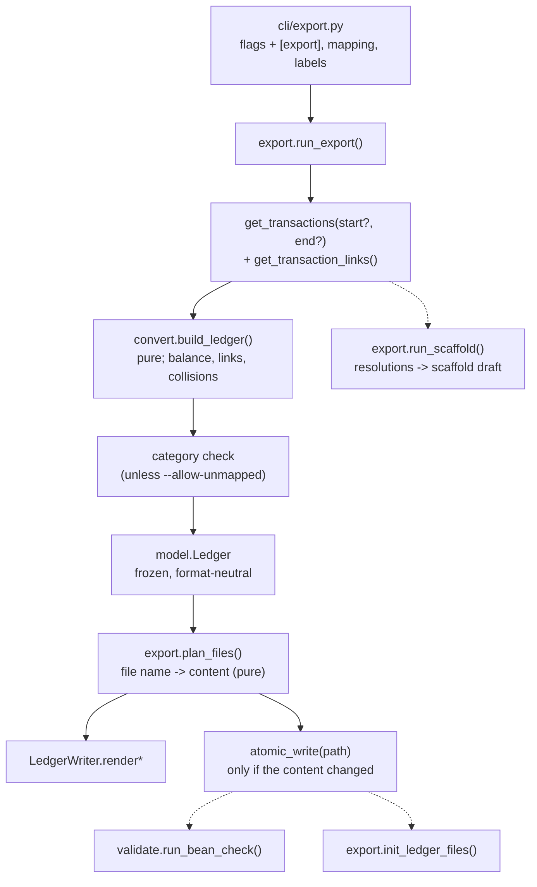
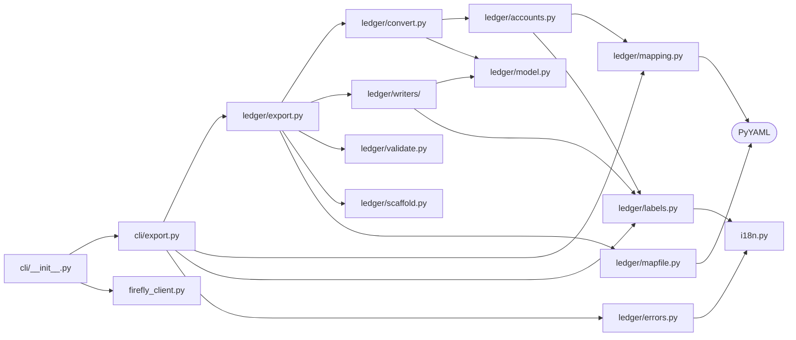
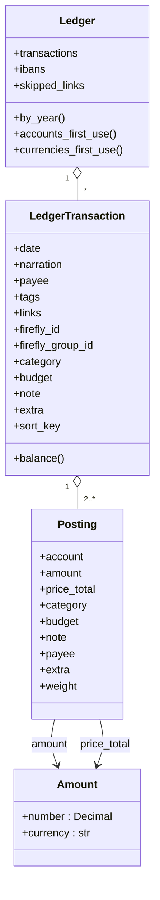
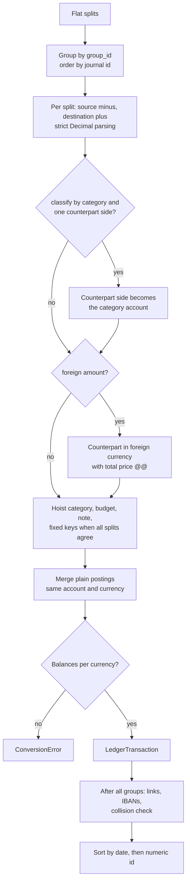
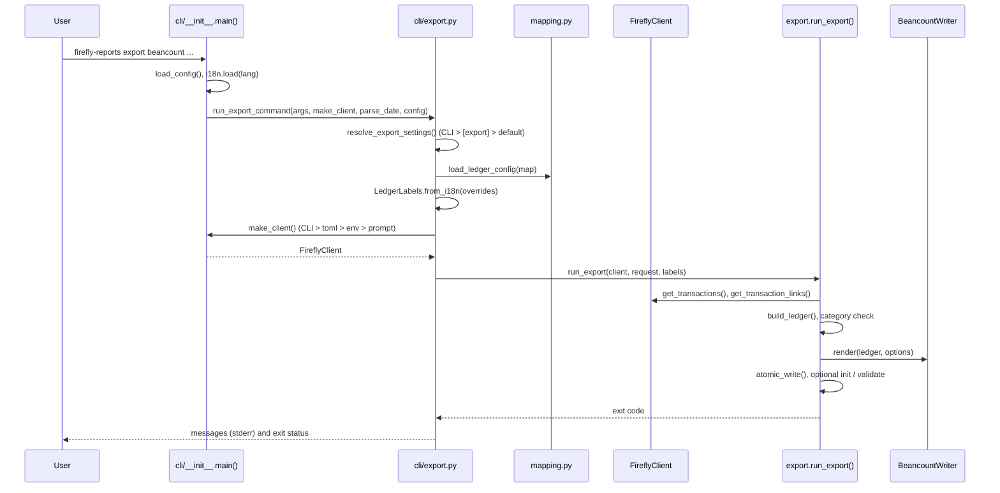
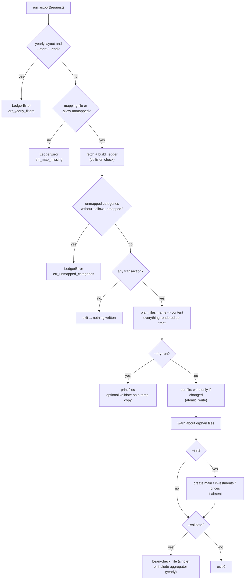

# Ledger Architecture

This page describes how the plain-text-accounting export (`firefly_reports/ledger/`, run by
`firefly-reports export beancount`) is built: the data flow, the modules and their layering, the neutral
model, the conversion and account-resolution rules, the writer contract, and how to add another output
format such as hledger. It is for developers; the user guide is [[Beancount-Export|Beancount Export]].

## Goals and non-goals

- Reuse the API client, the credentials, the configuration and the translations of the report command;
  add no network code outside `firefly_client.py`.
- Separate **fetch -> neutral model -> writer**, so a new format is a new writer only.
- Money is `Decimal` end to end; mapping and conversion are testable without the network.
- Deterministic output and atomic writes.
- Non-goal: investment positions (Firefly III has no quantities or prices).

## Data flow

An export runs these steps in order:

1. **CLI** (`cli/export.py::run_export_command()`): merges the flags with the `[export]` section of
   `firefly-reports.toml` (`resolve_export_settings()`: CLI > config file > default), finds the mapping
   file (`--map`, else `./beancount_map.yaml` if present), loads it with `mapping.load_ledger_config()`,
   applies `--classify-by`, snapshots the translated labels with `LedgerLabels.from_i18n()`, builds the
   client through a factory injected by `cli/__init__.py` (so this module never imports it), and calls
   `export.run_export()` or, with `--scaffold`, `export.run_scaffold()`.
2. **Fetch**: `get_transactions(start, end, tx_type="all")` returns flat per-split dicts (omitted bounds
   are not sent to the API); `get_transaction_links(resolve_types=False)` returns the Firefly links.
3. **Convert** (`convert.build_ledger(splits, AccountResolver, links=...)`, pure): groups the splits,
   resolves accounts, checks that every transaction balances, attaches the links and the IBANs, checks
   for account collisions and sorts. The result is a format-neutral `model.Ledger`.
4. **Category check** (category mode): categories the mapping does not list stop the export with
   `ledger.err_unmapped_categories`, unless `--allow-unmapped`.
5. **Plan** (`export.plan_files(ledger, layout, writer, options)`, pure): file name -> complete content
   for the chosen layout. Everything is rendered before the first file is written.
6. **Write**: each file is replaced through `writers.base.atomic_write()`, and only when its content
   changed. Generated files that this run did not produce are reported (`find_orphans()`), never deleted.
7. **Optional steps**: `--init` creates the starter files (`init_ledger_files()`); `--validate` runs
   `bean-check` (`validate.run_bean_check()`).

With `--dry-run` step 6 prints the files to stdout instead (and `--validate` checks temporary copies).

Diagram: the export data flow, from the CLI to the files (dotted arrows are optional steps).



The scaffold (`--scaffold`) shares steps 1 to 3 but stops before the writers: it builds the ledger with
`check_collisions=False` so that clashes are reported in the drafted YAML instead of aborting, and it
never writes a ledger file.

## Module map

`cli/__init__.py` builds the client from `firefly_client.py` and calls `cli/export.py`, which uses
`ledger/export.py` (orchestration), `mapping.py`, `labels.py` and `errors.py`. `export.py` drives
`convert.py`, the writers, `validate.py`, `scaffold.py` and `mapfile.py`; `convert.py` relies on
`accounts.py` and `model.py`; `accounts.py` reads the mapping and the labels; the writers use the model
and the labels; labels and errors reach the translations through `i18n.py`; `mapping.py` and `mapfile.py`
use PyYAML.

Diagram: import dependencies of the ledger modules.



| Module | Responsibility | Depends on |
|---|---|---|
| `ledger/model.py` | `Amount`, `Posting`, `LedgerTransaction`, `Ledger`; balance, per-year split and first-use helpers; `FIXED_META_KEYS` | stdlib |
| `ledger/errors.py` | `LedgerError(message_key, **params)` (a `FireflyReportsError`) and its subclasses `ConfigError`, `ConversionError`, `AccountCollisionError` | `errors` |
| `ledger/labels.py` | `LedgerLabels`: translated strings and validated metadata keys | `i18n`, `ledger.errors`, `model` |
| `ledger/mapping.py` | `LedgerConfig`, `parse_ledger_config()`, `load_ledger_config()` (PyYAML) | `errors`, `labels` |
| `ledger/accounts.py` | `normalize_component()`, `classify()`, `AccountResolver` (precedence, category accounts, collisions, `Resolution` and `CategoryUse` records) | `mapping`, `labels`, `errors` |
| `ledger/convert.py` | Firefly splits -> `LedgerTransaction`: grouping, posting pairs, foreign amounts, metadata hoisting, merging, links, IBANs, balance check | `accounts`, `model`, `errors` |
| `ledger/writers/base.py` | `LedgerWriter` protocol, `WriterOptions`, `atomic_write()` | `labels`, `model` |
| `ledger/writers/beancount.py` | `BeancountWriter`, `quote()`, `format_number()` | `writers.base`, `model` |
| `ledger/validate.py` | Optional `bean-check` runner (`shutil.which` + `subprocess` with an argument list, no shell) | stdlib |
| `ledger/scaffold.py` | The draft of `beancount_map.yaml` and the tables printed by `--scaffold` (pure, templated text so the comments survive) | `accounts`, `i18n` |
| `ledger/mapfile.py` | Safe textual edits of an existing mapping file for `--scaffold --append` (inserts entries, keeps the user's lines and line endings) | PyYAML |
| `ledger/export.py` | `ExportRequest`, `plan_files()` (layouts), `run_export()`, `run_scaffold()`, `--init` files, orphan detection, validation | all of the above |
| `cli/export.py` | The `export <format>` parser, `ExportSettings` and `resolve_export_settings()`, `run_export_command()` (exit codes) | `ledger.*`, `i18n` |

Rules: `model`, `convert`, `accounts`, `scaffold`, `mapfile` and the writers do no I/O; only `export.py`,
`validate.py`, `writers/base.atomic_write()` and `mapping.load_ledger_config()` touch the disk or start
processes. Writers never call `i18n`: they receive a `LedgerLabels`. `ledger/` imports none of
`reports`, `render`, `cli` or `api` (checked by `tests/test_architecture.py`). `ledger/export.py` still
prints its messages itself; it is the one module outside `cli/` allowed to call `print`.

## The neutral model

- `Amount(number: Decimal, currency: str)`.
- `Posting(account, amount, price_total=None, category=None, budget=None, note=None, payee=None,
  extra=())`. `price_total` is a **total** price (Beancount `@@`). `Posting.weight` is the amount that
  counts for balancing: the price total (signed like the units) when present, otherwise the amount.
  `payee` is set on a posting only when the splits of a group have different counterparts; `extra` holds
  the fixed-key metadata that differs between splits.
- `LedgerTransaction(date, narration, postings, firefly_id, firefly_group_id=None, payee=None, tags=(),
  category=None, budget=None, note=None, extra=(), links=())`. `sort_key` is
  `(date, numeric id, id string)`; `balance()` returns the residual per currency (all zeros for a valid
  transaction).
- `Ledger(transactions, ibans={}, skipped_links=0)` with `by_year()`, `accounts_first_use()` and
  `currencies_first_use()` (both sorted).

`FIXED_META_KEYS` are `bill`, `reference`, `external_id`, `external_url`, `book_date` and
`interest_date`: written verbatim, never translated.

The model carries semantics, not syntax: flag characters, metadata key names and quoting belong to the
writer and its labels. A `Ledger` holds one `LedgerTransaction` per Firefly transaction group, each with
two or more postings, and each posting has an `amount` and an optional `price_total`, both `Amount`s.

Diagram: the classes of the neutral model and how they contain each other.



## Conversion (`convert.py`)

The numbered steps below are the reference; the diagram summarises them.

Diagram: the conversion algorithm, from flat splits to sorted transactions.



1. **Group** the flat splits by `group_id` (fallback: journal id). Within a group, splits are ordered by
   numeric journal id.
2. **Pair postings** for each split (`_split_postings`): source `-amount`, destination `+amount`, in
   `currency_code`. Amounts go through a strict `Decimal` parser; `NaN`, `Infinity`, empty or invalid
   values raise `ConversionError` (no silent zero). `_negate` avoids `-0.00`.
3. **Classify by category** (default, `classify_by: category`): when exactly one side of the split is an
   expense or revenue counterpart, that side's account comes from the Firefly **category**
   (`AccountResolver.resolve_category()`, separate `expense` and `income` lanes) and the counterpart name
   survives as payee. Transfers, and any split with two real sides, keep the real accounts and a
   `category` metadata. With `classify_by: account` the counterpart accounts are used as before.
4. **Foreign amount**: if `foreign_currency_code` differs from the base currency and `foreign_amount` is
   non-zero, the counterpart posting is expressed in the foreign currency with
   `price_total = |amount|` in the base currency. Counterpart = source for `deposit`, destination
   otherwise.
5. **Uniform metadata**: category, budget, note and the fixed keys are hoisted to the transaction when
   every split agrees, otherwise they stay on the posting that carries the split's metadata.
6. **Header fields**: date = the earliest split date; narration = the description (for a multi-split
   group, the group title, else the distinct descriptions joined with `; `); payee = the counterpart when
   all splits share one that is not a placeholder (`(no name)`, `(empty)`, `(cash)`); tags normalised
   (characters Beancount does not allow become `-`).
7. **Merge** (`_merge_postings`): postings with the same account and currency, no price and no metadata
   are summed, preserving first-seen order.
8. **Balance check**: `tx.balance()` must be all zeros, otherwise `ConversionError("ledger.err_unbalanced")`.
9. **Links**: both ends of a Firefly transaction link get the same `^firefly-link-<id>` link; a link with
   an end outside the exported set is dropped and counted (`skipped_links`, reported as a warning).
10. **IBANs**: for each real account, the most frequent IBAN of its splits (ties alphabetical), written on
    the `open` directive.
11. After all groups, `AccountResolver.raise_on_collisions()` (unless disabled), then a stable sort by
    `sort_key`.

## Account resolution (`accounts.py`)

`AccountResolver.resolve(name, firefly_type, account_id, side)`:

1. `classify()` maps the Firefly account type string (`"Asset account"`, `"Expense account"`, `"Loan"`,
   `"Initial balance account"`, ...) to a kind; unknown types fall back to `expense` for destinations and
   `income` for sources.
2. Precedence: explicit `accounts` (numeric id first, then name) -> `investment_accounts` (asset kind
   only) -> opening balance, reconciliation and cash specials -> fallback (empty or placeholder name, or
   strict mode on an expense/revenue account) -> `normalize_component()` under the root of the kind.
3. Every result is recorded as `ledger account -> {(kind, Firefly name): explicit?}`. A collision is a
   ledger account with more than one identity where at least one was generated **automatically**.
   Explicit many-to-one mapping is intentional and never reported.
4. Each decision is also stored as a `Resolution(name, firefly_type, kind, account, origin)`, with origin
   `explicit`, `investment`, `special`, `fallback` or `auto`; `resolutions()` feeds the scaffold and its
   table.

`resolve_category(name, lane)` does the same for categories: an entry under `categories.expense` or
`categories.income` wins; an empty or placeholder name, or strict mode, gives the fallback account;
otherwise `Expenses:<Name>` or `Income:<Name>`. Every use is counted per lane, which gives the split
counts in the scaffold (`category_uses()`), the unmapped categories (`unmapped_categories()`) and the
mapping keys never seen in the data (`unused_category_keys()`, reported as a warning).

`normalize_component()`: transliterate the letters NFKD cannot decompose (`ß ø æ œ đ ł`), apply NFKD and
drop combining marks, replace each run of `[^A-Za-z0-9]` by `-`, strip dashes, capitalise the first letter.

## Writer contract and the Beancount writer

```python
class LedgerWriter(Protocol):
    extension: str                                                  # ".beancount"
    def render(self, ledger, options) -> str: ...                 # self-contained single file
    def render_accounts(self, ledger, options) -> str: ...        # commodity + open only
    def render_transactions(self, ledger, options) -> str: ...    # transactions only


@dataclass(frozen=True)
class WriterOptions:
    labels: LedgerLabels
    commodities: tuple[str, ...] = ()
    generated_at: datetime | None = None   # None -> no timestamp line
```

Every method returns a complete file (header included). `BeancountWriter.render()` is the directives of
`render_accounts()` followed by the transactions of `render_transactions()` under one header: `commodity`
directives, `open` directives (with `iban` metadata where known), then each transaction. Transactions
always carry the `*` flag; the header line also holds the payee, the narration, `#tags` and
`^firefly-link-<id>` links. Number alignment uses **per-file** column widths, so a long new account name
does not rewrite closed years. Strings go through `quote()` (escapes `\` and `"`, flattens newlines);
numbers through `format_number()` (positional, decimals preserved).

The `; Generated:` timestamp is written only where a rerun is expected to rewrite the file anyway:
`render_accounts()` and the single-file `render()`. `render_transactions()` (the per-year files) never
carries it, so unchanged years stay byte-identical and are not rewritten.

Layouts (`export.plan_files()`): `single` gives one `firefly.beancount`; `yearly` (the default) gives
`accounts.beancount` plus one `firefly-YYYY.beancount` per year of `Ledger.by_year()`.

`--init` writes `main.beancount` (`render_main_beancount()`: `option "title"`, `option
"operating_currency"`, a Fava `custom "fava-option" "language"` directive, the includes of the generated
files and of `investments.beancount` and `prices.beancount`) plus the two empty stubs, each only if
missing. The output language goes into a Fava custom directive because Beancount rejects unknown
`option` lines.

Determinism checklist for any writer: iterate only over sorted structures, never over `dict` or `set`
order you did not build deterministically, no locale-dependent formatting, no environment-dependent data
except the optional timestamp.

## i18n design

- Strings live under `[ledger]` in both `translations/en.toml` and `it.toml` (keys must match).
- `LedgerLabels.from_i18n(overrides)` snapshots the active language into an immutable object. Metadata
  keys are validated against `[a-z][a-zA-Z0-9_-]*`, must not clash with each other or with the technical
  and fixed keys; a test checks both languages.
- Errors store a message key and parameters; `str(exc)` translates at display time. Add a key to
  **both** TOML files whenever you add a message.
- Technical keys (`firefly_id`, `firefly_group_id`) are constants of `LedgerLabels` and not translated.

## CLI wiring

- `cli/export.add_export_parser()` registers `export <format>`. The global options (`--url`, `--token`,
  `--lang`, `--debug`, `--debug-file`) and `--start`, `--end`, `--out` use `argparse.SUPPRESS`, so values
  given before the subcommand are kept (argparse would otherwise let the subparser defaults overwrite
  them).
- `cli/__init__.py::_dispatch()` builds the client factory from `resolve_credentials()` (CLI >
  `firefly-reports.toml` > environment > prompt) and `make_client()`, and passes it with `parse_cli_date`
  and the loaded config to `run_export_command()`.
- `run_export_command()` rejects invalid flag combinations (`--append` or `--overwrite` without
  `--scaffold`, or both; `--start`/`--end` with the yearly layout), an explicit `--map` that does not
  exist (except with `--scaffold`), and maps `LedgerError` and `requests.RequestException` to exit code 1.
- `--scaffold --overwrite` asks the user to type the mapping file name (`confirm_overwrite()`), and
  refuses when stdin is not interactive.
- `run_export()` returns 1 when the result is empty (it never empties existing files); `--validate`
  returns 1 when `bean-check` reports problems and 2 when `bean-check` is not installed.

Diagram: the call sequence of one `export beancount` run, from the user to the writer.



## `run_export` step by step

`run_export()` first refuses `--start/--end` with the yearly layout and a missing mapping file (unless
`--allow-unmapped`). It then fetches and converts, stops on unmapped categories, and returns 1 without
touching any file when there are no transactions. It renders every file up front; with `--dry-run` it
prints them (and validates temporary copies with `--validate`); otherwise it writes only the changed
files, warns about orphans, runs `--init` and finally `--validate`.

Diagram: the decisions inside `run_export()` and their outcomes.



## Safety properties

- `atomic_write()`: temporary file in the target directory, `os.replace`, the mode of an existing target
  preserved (default 0644), the temporary file removed on failure. The previous file survives any error.
- `--init` creates `main.beancount`, `investments.beancount` and `prices.beancount` only when absent.
- `run_export()` renders **every** file before writing the first one; unchanged files are not
  rewritten; files it did not produce are only reported, never deleted.
- The export stops (exit 1, nothing written) without a mapping file, or with categories the mapping does
  not list, unless `--allow-unmapped`.
- The scaffold never modifies an existing mapping file unless asked: `--append` inserts the missing
  entries through `mapfile.append_entries()` after a `.bak` copy, and only if the result still parses,
  keeps every existing entry and contains the new ones; `--overwrite` keeps a timestamped
  `.bak-<timestamp>` copy.
- `validate.run_bean_check()` uses an argument list and the path from `shutil.which`; no shell.
- No token is written to any output or log by this code path.

## Adding a new format (hledger example)

1. Create `firefly_reports/ledger/writers/hledger.py` with a class that implements `LedgerWriter`
   (`extension`, `render`, `render_accounts`, `render_transactions`). An illustrative `render()`:

   ```python
   class HledgerWriter:
       extension = ".journal"

       def render(self, ledger: Ledger, options: WriterOptions) -> str:
           lines = [f"; {options.labels.header_notice}"]
           for tx in ledger.transactions:
               lines.append(f"{tx.date:%Y-%m-%d} * {tx.payee or ''} | {tx.narration}")
               for p in tx.postings:
                   price = f" @@ {p.price_total.number} {p.price_total.currency}" if p.price_total else ""
                   lines.append(f"    {p.account}  {p.amount.number} {p.amount.currency}{price}")
           return "\n".join(lines) + "\n"
   ```

   hledger has its own account-name and escaping rules, so also add a normaliser or a style switch in
   `AccountResolver` and its own quoting.
2. Export it in `ledger/writers/__init__.py`.
3. Add the format to `FORMATS` in `cli/export.py` and select the writer in `run_export_command()`
   (`run_export(..., writer=HledgerWriter())`; `run_export` and `plan_files` already accept any
   `LedgerWriter`).
4. Add tests: unit tests for the writer, a determinism test, and an integration test guarded by
   `shutil.which("hledger")`.
5. Update the user page, `README.md`, `CHANGELOG.md` and `AGENTS.md`.

`convert.py`, `model.py` and the Firefly client need no change. If the new format needs different account
rules, make them a parameter of `AccountResolver` rather than forking it.

## Tests

| File | Covers |
|---|---|
| `tests/test_ledger.py` | Normalisation, resolver precedence and collisions, mapping validation, conversion of every transaction type, splits, foreign amounts, writer text and escaping, atomic write, i18n, export orchestration, `bean-check` integration |
| `tests/test_ledger_category_mode.py`, `tests/test_ledger_categories.py`, `tests/test_ledger_config.py` | Conversion by category, category -> account resolution, the mapping-file sections for categories |
| `tests/test_ledger_scaffold_categories.py`, `tests/test_ledger_scaffold_modes.py`, `tests/test_ledger_mapfile.py` | Scaffold drafts, `--append` and `--overwrite`, safe edits of the mapping file |
| `tests/test_ledger_safety_block.py` | The export blocked without a mapping or with unlisted categories |
| `tests/test_ledger_links_export.py`, `tests/test_ledger_extras.py` | Links, fixed-key metadata and IBANs |
| `tests/test_ledger_layout.py` | Yearly and single layouts (partition, determinism, no-op reruns, orphans), `bean-check` of the yearly set, the scaffold, two-pass CLI flow |
| `tests/test_ledger_writer.py` | Writer output on hand-built ledgers: flag, links, extra metadata, IBAN |
| `tests/test_ledger_invariants.py` | Properties that must hold whichever way expenses and income are classified |
| `tests/test_ledger_account_types.py` | Account types the main fixture does not cover, end to end |
| `tests/test_ledger_cli.py`, `tests/cli/test_export_settings.py` | Argument parsing, `[export]` settings, `--dry-run`, `--init`, errors and exit codes |
| `tests/test_golden_ledger_cli.py` | Golden snapshots of both layouts |
| `tests/fixtures/firefly_transactions.json` | API-shaped payload with every transaction shape the export handles |

Tests that call `bean-check` are skipped when it is not installed (`python -m pip install beancount` to
run them). See [[Testing]].
